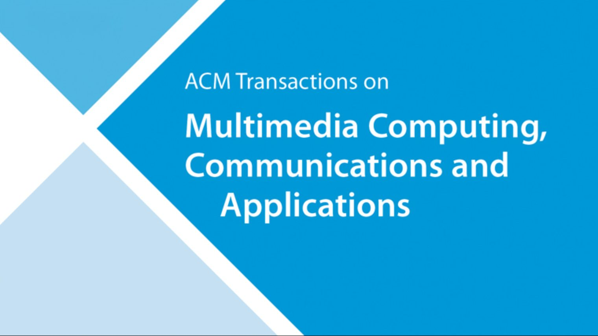

<figure class="board-fig"></figure>

### **Motion-to-Attention: Enhancing Attention Maps to Improve Performance of Text-Guided Video Editing**

ACM Transactions on Multimedia Computing, Communications, and Applications (**ACM TOMM**), 2026. (IF: 6.0, JCR 7.8%)

Seong-Hun Jeong\*, In-Hwan Jin\*, Haesoo Choo\*, Hyeonjun Na\*, Kyeongbo Kong†
