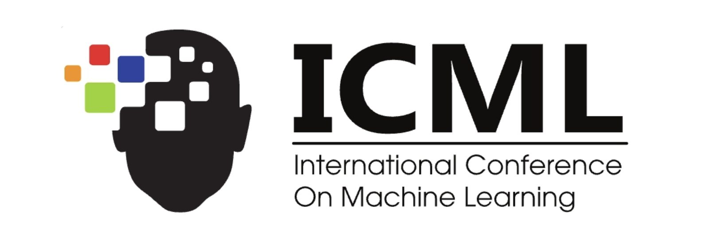

<figure class="board-fig"></figure>

# **Efficient Visual Token Compression for 3D Question Answering**

ICML Workshop on efficient multimodal question answering (**ICMLw**), Jul. 2026. Changwoo Baek\*, Kyeongbo Kong†

# **Mitigating Visual Hallucinations for Reliable Multimodal Agents**

ICML Workshop on Agents in the Wild: Safety, Security, and Beyond (**ICMLw**), Jul. 2026. Sohyeon Kim\*, Sang Yeon Yoon, Kyeongbo Kong†

# **Failure-Aware Query Refinement for Reliable Open-Vocabulary Home-Robot Perception**

ICML Workshop on Agents in the Wild: Safety, Security, and Beyond (**ICMLw**), Jul. 2026.  Daun Jeong\*, Sohyeon Kim\*, Jouwon Song, Kyeongbo Kong†

# **Attention Weight Decomposition for Vision Model Compression**

ICML Workshop on Weight-Space Symmetries: from Foundations to Practical Applications (**ICMLw**), Jul. 2026.  Hyunwoo Yu\*, Yubin Cho\*, Kyeongbo Kong†, Suk-Ju Kang†

# **Compositional Agentic Formulation Search for Open-Vocabulary Audio-Visual Event Localization**

ICML Workshop on Compositional Learning: Safety, Interpretability, and Agents (**ICMLw**), Jul. 2026. Beomgwon Jo\*, Sunchan Park\*, Kyeongbo Kong†

# **HYBRIDKV: Exploiting Head-Dominant Reconstruction for Efficient Query-Agnostic KV Cache Compression**

ICML Workshop on AdaptFM: Resource-Adaptive Foundation Model Inference (**ICMLw**), Jul. 2026. Changwoo Baek\*, Kyeongbo Kong†

# **SFPruner: Single-Forward Visual Token Subset Selection for Resource-Efficient Multimodal Foundation Model Inference**

ICML Workshop on AdaptFM: Resource-Adaptive Foundation Model Inference (**ICMLw**), Jul. 2026. Jouwon Song\*, Woohyeong Kim, Seungjae Baek, Kyeongbo Kong†

# **Reducing Attention Distribution Error with Unified Tail Aggregation for Sparse Attention**

ICML Workshop on AdaptFM: Resource-Adaptive Foundation Model Inference (**ICMLw**), Jul. 2026. Hyunwoo Yu\*, Jongbeom Lee, Jaemin Choi, Jincheol Yang, Yubin Cho, Joonsik Nam, Seunghun Moon, Jung-Woo Chang, Bongjoon Hyun, Kyomin Sohn, Kyeongbo Kong†, Suk-Ju Kang†
