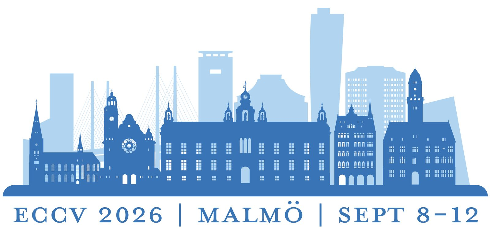

<figure class="board-fig"></figure>

# LivingWorld: Interactive 4D World Generation with Environmental Dynamics

European Conference on Computer Vision (**ECCV**), Sep. 2026. **(Top-tier AI Conference, Acceptance Rate: 27.5%)**

Hyeongju Mun*, In-Hwan Jin*, Sohyeong Kim, Kyeongbo Kong†

[`Paper`](https://arxiv.org/pdf/2604.01641) [`Project Page`](https://paper.pnu-cvsp.com/LivingWorld/)

# TRiGS: Temporal Rigid-Body Motion for Scalable 4D Gaussian Splatting

European Conference on Computer Vision (**ECCV**), Sep. 2026. **(Top-tier AI Conference, Acceptance Rate: 27.5%)**

Suwoong Yeom*, Joonsik Nam*, Seunggyu Choi*, Lucas Yunkyu Lee, Sangmin Kim, Jaesik Park, Joonsoo Kim, Kugjin Yun, Kyeongbo Kong†, Suk-Ju Kang†

[`Paper`](https://arxiv.org/pdf/2604.00538) [`Project Page`](https://wwwjjn.github.io/TRiGS-project_page/)

# 3DZip: Spatial-Aware Feature Diversity-Guided Token Compression for 3D Question Answering

European Conference on Computer Vision (**ECCV**), Sep. 2026. **(Top-tier AI Conference, Acceptance Rate: 27.5%)**

Changwoo Baek*, Kyeongbo Kong†

[`Project Page`](https://paper.pnu-cvsp.com/3DZip/) [`Code`](https://github.com/cvsp-lab/3DZip)

# Structured Redundancy Modeling for Efficient Visual Token Pruning in High-Resolution MLLMs

European Conference on Computer Vision (**ECCV**), Sep. 2026. **(Top-tier AI Conference, Acceptance Rate: 27.5%)**

Jouwon Song*, Woohyeong Kim, Kyeongbo Kong†

[`Paper`](https://arxiv.org/pdf/2607.23046)
