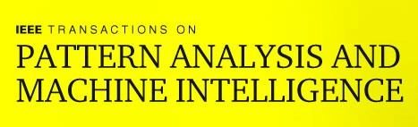

<figure class="board-fig"></figure>

### **On the Design of Mixture-of-Experts for Dynamic Gaussian Splatting**

IEEE Transactions on Pattern Analysis and Machine Intelligence (**IEEE TPAMI**), 2026. (IF: 20.4, JCR 0.9%)

In-Hwan Jin\*, Hyeongju Mun\*, Joonsoo Kim, Kugjin Yun, Kyeongbo Kong†
