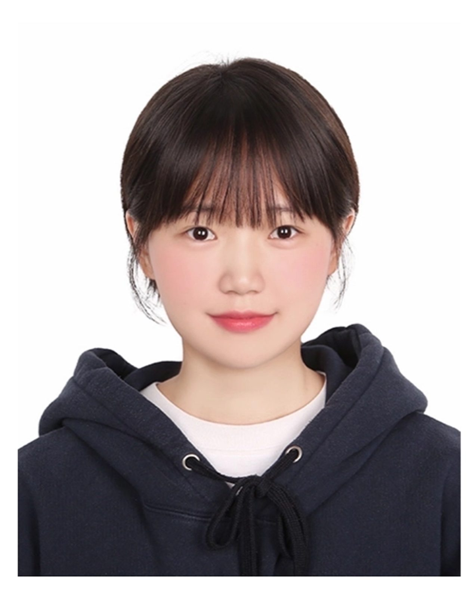
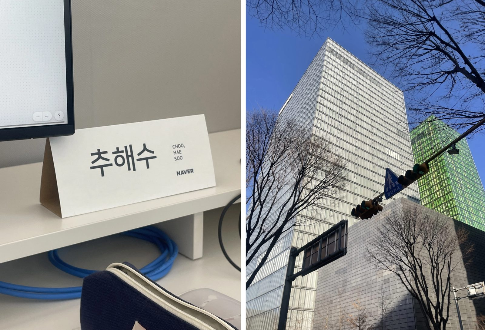

<figure class="board-fig"></figure>

<figure class="board-fig"></figure>

**우리 연구실 추해수 학생이 국내 최대이자 글로벌 시장을 선도하는 웹툰 플랫폼인 ‘네이버웹툰(NAVER WEBTOON) 기업부설연구소 AI V-agent팀에 최종 합격 했습니다.**

이번 정규직 합격은 인턴십 기간 동안 보여준 뛰어난 기술적 역량과 성실한 업무 수행 능력을 인정받아 이룬 값진 성과입니다. 특히 연구실에서 쌓아온 인공지능과 컴퓨터비전 분야의 연구 경험을 실제 콘텐츠 및 서비스 환경에 적용하며, 인턴십에 이어 정규직 합격이라는 결실을 이루었다는 점에서 더욱 의미가 큽니다.

AI V-Agent팀은 생성형 AI와 멀티모달 기술을 기반으로 웹툰의 시각적 요소와 서사를 이해하고, 콘텐츠 제작 과정에서 요구되는 다양한 작업을 지능적으로 연계하는 기술을 연구·개발하고 있습니다. 특히 작품 분석부터 장면 구성, 영상 생성 및 편집에 이르는 복합적인 제작 과정을 하나의 AI 기반 파이프라인으로 연결함으로써, 웹툰 콘텐츠를 새로운 미디어 경험으로 확장하고 있습니다.

인턴십 합격에 이어 정규직 합격이라는 뜻깊은 성과를 이룬 추해수 학생의 노력과 열정에 박수를 보내며, 다시 한번 진심으로 축하합니다. 앞으로 네이버웹툰의 AI 에이전트 기술과 글로벌 콘텐츠 혁신에 기여할 추해수 학생의 멋진 활약을 기대합니다!

## **Publication**

---

### International Journal Papers

**[J1] Motion-to-Attention: Enhancing Attention Maps to Improve Performance of Text-Guided Video Editing**

Seong-Hun Jeong*, In-Hwan Jin*, **Haesoo Choo***, Hyeonjun Na*, Kyeongbo Kong†

**ACM Transactions on Multimedia Computing, Communications, and Applications (ACM TOMM)** (IF: 6.0, JCR 7.8%)

[`Project Page`](https://currycurry915.github.io/Motion-to-Attention/)  [`Code`](https://github.com/currycurry915/ACMTOMM_M2A) 

### **International Conference Papers**

**[C4] Optimizing 4D Gaussians for Dynamic Scene Video from Single Landscape Images**  
In-Hwan Jin*, **Haesoo Choo***, Seong-Hun Jeong, Heemoon Park, Junghwan Kim, Oh-joon Kwon, Kyeongbo Kong†

**ICLR** 2025, Apr, 2025  ****(Top-tier AI conference, Acceptance Rate: 32.08%)

**[C3] Dynamic Scene Reconstruction from Single Landscape Image Using 4D Gaussian in the Wild**

In-Hwan Jin*, **Haesoo Choo***, Seong-Hun Jeong**,** Heemoon Park, Junghwan Kim, Oh-joon Kwon, Kyeongbo Kong†

**ECCVW** 2024, Sep, 2024

**[C2]4D Gaussian Splatting for Multi-view 3D Cinemagraphy**

In-Hwan Jin*, **Haesoo Choo***,  ****Kyeongbo Kong†

**IMID** 2024 **(Invited)**

**[C1] Enhancing Text-to-Video Editing with Motion Map Injection**  
Seong-Hun Jeong*, Inhwan Jin*, **Haesoo Choo***, Hyunjun Na*, Kyeongbo Kong**†**

**ICCVW***,* Oct. 2023. (Top-tier AI conference workshop) **(Oral Presentation Invitation)**
