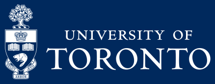
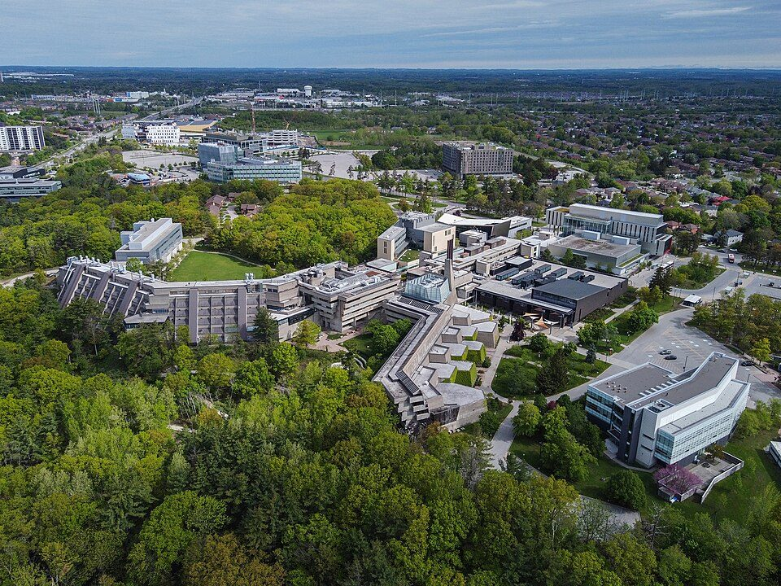
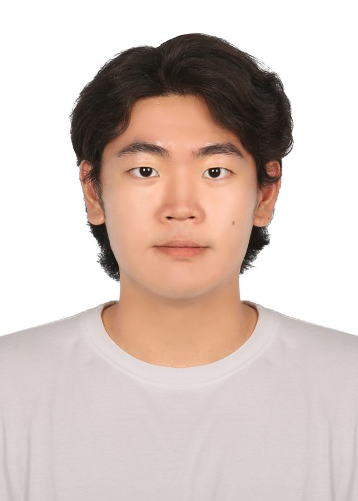

<figure class="board-fig"></figure>

<figure class="board-fig"></figure>

<figure class="board-fig"></figure>

**In-Hwan Jin** has been selected for the **2027 University of Toronto AI Convergence Education Program**.

He will participate in a six-month AI education program at the University of Toronto, including advanced AI coursework and an applied AI project.

Congratulations! 🎉
