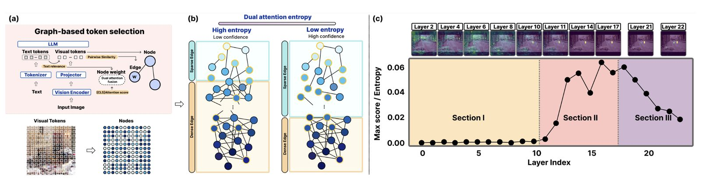

<figure class="board-fig"></figure>

김소현 석사과정생

<figure class="board-fig"></figure>

### 온디바이스 멀티모달 대형 언어 모델의 자원 효율적 추론 및 환각 완화 기술 개발 **-** [**김소현**](/members/sohyeon/)

**Development of Resource-Efficient Inference and Hallucination Mitigation Techniques for On-Device Multimodal Large Language Models (2026.09.01-2027.08.31)**

- 멀티모달 대형 언어 모델(MLLM)의 온디바이스 추론 과정에서 불필요한 연산을 줄이고 신뢰성을 향상하기 위한 **효율적인 비주얼 토큰 경량화 및 환각 완화 기법 연구**
- **Funded by the Ministry of Education through the National Research Foundation of Korea (NRF)**

  *(2026 Basic Science Research Program – Master’s Student Research Encouragement Grant)*
