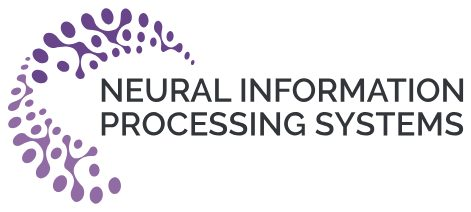

<figure class="board-fig"></figure>

# Focus Matters: Attention-Value Dynamics for Efficient Hallucination Mitigation in Vision-Language Models

Neural Information Processing Systems (**NeurIPS**), Sep. 2026. (Top-tier AI Conference, Acceptance Rate: 25.7%)

Sohyeon Kim\*, Sang Yeon Yoon, Kyeongbo Kong†

[<code>Paper</code>](https://arxiv.org/pdf/2604.03556)  [<code>Project Page</code>](https://paper.pnu-cvsp.com/FocusMatters/)
