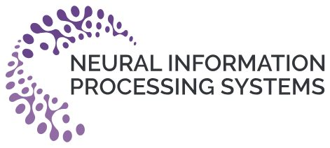

<figure class="board-fig"></figure>

# OmniWhere: Agentic Audio-Visual Perception for Embodied Spatial Reasoning

Neural Workshop on Embodied Spatial Reasoning (**NeurIPSW**), Sep. 2026. (**Top-tier AI Conference Workshop**)

Sunchan Park, Kyeongbo Kong
