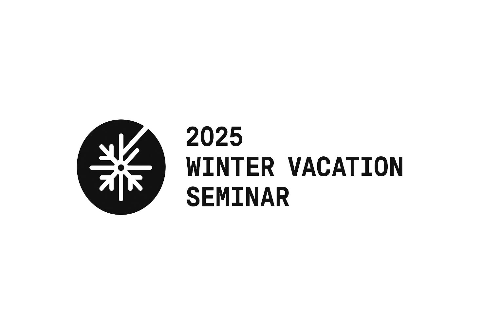

<figure class="board-fig"></figure>

2025-01-25  

- RGB to IR transformation via text-guided feature representation <u>**BY 정다운**</u>

  [📎 \[2025 winter seminar\] 정다운.pdf](/images/gallery/board/seminar-2025-01-25-2025-winter-vacation-seminar/02.pdf)

2025-02-07

- Protecting Against Editing by Diffusion Model <u>**BY 정성훈**</u>

  [📎 \[2025 winter seminar\] 정성훈.pdf](/images/gallery/board/seminar-2025-01-25-2025-winter-vacation-seminar/03.pdf)

2025-02-14  

- Video Anomaly Detection with Synthetic Dataset <u>**BY 김태훈**</u>

  [📎 \[2025 winter seminar\] 김태훈.pdf](/images/gallery/board/seminar-2025-01-25-2025-winter-vacation-seminar/04.pdf)

2025-02-14  

- Prompt Learning with Knowledge Distillation <u>**BY 백창우**</u>

  [📎 \[2025 winter seminar\] 백창우.pdf](/images/gallery/board/seminar-2025-01-25-2025-winter-vacation-seminar/05.pdf)

2025-02-21

- Video Anomaly Detection by memory and Jigsaw Puzzles <u>**BY 이우진**</u>

  [📎 \[2025 winter seminar\] 이우진.pdf](/images/gallery/board/seminar-2025-01-25-2025-winter-vacation-seminar/06.pdf)

2025-02-14  

- Dynamic Scene Generation from a Single Image <u>**BY 진인환**</u>

  [📎 \[2025 winter seminar\] 진인환.pptx](https://www.notion.so/1e7abcc90e3480a3892ff2c1f2da5678)

2025-02-21

- Dynamic 3DGaussians <u>**BY 문형주**</u>

  [📎 \[2025 winter seminar\] 문형주.pdf](/images/gallery/board/seminar-2025-01-25-2025-winter-vacation-seminar/08.pdf)

2025-02-28  

- OoDSegmentation <u>**BY 우민수**</u>

  [📎 \[2025 winter seminar\] 우민수.pdf](/images/gallery/board/seminar-2025-01-25-2025-winter-vacation-seminar/09.pdf)

2025-03-21  

- CS231N review 및 Hyperparameter Tuning <u>**BY 안재현**</u>

  [📎 \[2025 winter seminar\] 안재현.pptx](https://www.notion.so/1e7abcc90e348010946dea6d9a9d9dd2)

2025-03-28  

- Image classification <u>**BY 김소현**</u>

  [📎 \[2025 winter seminar\] 김소현.pptx](/images/gallery/board/seminar-2025-01-25-2025-winter-vacation-seminar/11.pptx)

2025-05-20  

- CS231 및 CNN 코드 <u>**BY 김소형**</u>

  [📎 \[2025 winter seminar\] 김소형.pdf](/images/gallery/board/seminar-2025-01-25-2025-winter-vacation-seminar/12.pdf)
