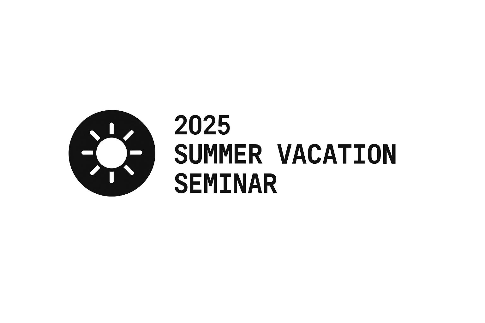

<figure class="board-fig"></figure>

2025-07-21  

**주제: 4D Gaussian Editing using video editing model**

1. InFusion: Inpainting 3D Gaussians via Learning Depth Completion from Diffusion Prior \[arxiv 2024.04\]
2. Señorita-2M: A High-Quality Instruction-based Dataset for General Video Editing by Video Specialists \[arxiv 2025.05\]

발표자: [정성훈](/members/shj/)

[📎 \[2025 summer seminar\] 정성훈.pdf](/images/gallery/board/seminar-2025-07-21-2025-summer-vacation-seminar/02.pdf)

**주제: Understanding Mixture-of-Experts: A study in Efficient Scaling**

1. Outrageously Large Neural Networks: The Sparsely-Gated Mixture-of-Experts Layer \[ICLR 2017\]

2. MoE++: Accelerating Mixture-of-Experts Methods with Zero-Computation Experts \[ICLR 2025 Oral\]

발표자: [진인환](/members/inhwan/)

[📎 \[2025 summer seminar\]진인환.pdf](/images/gallery/board/seminar-2025-07-21-2025-summer-vacation-seminar/03.pdf)

**주제 : Motion modeling**

1. Generative Image Dynamics \[CVPR 2024 Best Paper Award\]

2. Motion-I2V: Consistent and Controllable Image-to-Video Generation with Explicit Motion Modeling\[ACM SIGGRAPH 2024\]

발표자: [문형주](/members/hyeong-ju/)

[📎 \[2025 summer seminar\] 문형주.pdf](/images/gallery/board/seminar-2025-07-21-2025-summer-vacation-seminar/04.pdf)

2025-07-28  

**주제 : Object change detection**

1. The Change You Want to See (Now in 3D) \[ICCV workshop 2023\]

2. Improving Zero-Shot Object-Level Change Detection by Incorporating Visual Correspondence \[WACV 2025\]

발표자: 이우진

[📎 \[2025 summer seminar\] 이우진.pdf](/images/gallery/board/seminar-2025-07-21-2025-summer-vacation-seminar/05.pdf)

**주제 : Visual Place Recognition**

1. ETR: An Efficient Transformer for Re-ranking in Visual Place Recognition \[WACV 2023\]

2. R2Former: Unified Retrieval and Reranking Transformer for Place Recognition\[CVPR 2023\]

발표자: [우민수](/members/msw/)

[📎 \[2025 summer seminar\] 우민수.pdf](/images/gallery/board/seminar-2025-07-21-2025-summer-vacation-seminar/06.pdf)

2025-08-14  

**주제 : Massive Activation in transformer architecture**

1. Vision Transformers Need Registers \[ICLR 2024\]
2. Efficient Streaming Language Models with Attention Sinks \[ICLR 2024\]

발표자: [백창우](/members/changwoo/)

[📎 \[2025 summer seminar\] 백창우.pdf](/images/gallery/board/seminar-2025-07-21-2025-summer-vacation-seminar/07.pdf)

**주제 : Vision Token Reduction in LVLMs**

1. \[CLS\] Attention is All You Need for Training-Free Visual Token Pruning: Make VLM Inference Faster
2. VScan: Rethinking Visual Token Reduction for Efficient Large Vision-Language Models

발표자: [김소현](https://www.pnu-cvsp.com/members/%7Bname%7D)

[📎 \[2025 summer seminar\]김소현.pdf](/images/gallery/board/seminar-2025-07-21-2025-summer-vacation-seminar/08.pdf)

2025-08-18  

**주제 : VLM/MLLM-based Agentic Systems: Methods and Applications**

1. AN INTELLIGENT AGENTIC SYSTEM FOR COMPLEXIMAGE RESTORATION PROBLEMS \[ICLR 2025\]

2. RestoreAgent: Autonomous Image Restoration Agent via Multimodal Large Language Models \[NeurIPS 2024\]

발표자: [정다운](/members/daun/)

[📎 \[2025 summer seminar\] 정다운.pdf](/images/gallery/board/seminar-2025-07-21-2025-summer-vacation-seminar/09.pdf)

**주제 : Object Detection via language modality**

1. YOLO-World: Real-Time Open-Vocabulary Object Detection \[CVPR 2024\]

2. Grounding DINO: Marrying DINO with Grounded Pre-Training for Open-Set Object Detection \[ECCV 2024\]

발표자: [김태훈](/members/taehoon/)

[📎 \[2025 summer seminar\] 김태훈.pdf](/images/gallery/board/seminar-2025-07-21-2025-summer-vacation-seminar/10.pdf)

2025-08-26  

**주제: Matryoshka Representation Learning with Structured Supervision**

1. Matryoshka Representation Learning \[NeurIPS 2022\]

2. Dimension-Specific Margins and Element-Wise Gradient Scaling for Enhanced Matryoshka Speaker Embedding \[IEEE Access, 2025\]

발표자: [박순찬](/members/parksunchan/)

[📎 \[2025 summer seminar\] 박순찬.pdf](/images/gallery/board/seminar-2025-07-21-2025-summer-vacation-seminar/11.pdf)

**주제: 3D Cinemagraphy**

1. LoopGaussian: Creating 3D Cinemagraph with Multi-view Images via Eulerian Motion Field \[ACM MM 2024\]

2. Optimizing 4D Gaussians for Dynamic Scene Video from Single Landscape Images \[ICLR 2025\]

발표자: [김소형](/members/sohyeong/)

[📎 \[2025 summer seminar\] 김소형.pdf](/images/gallery/board/seminar-2025-07-21-2025-summer-vacation-seminar/12.pdf)
