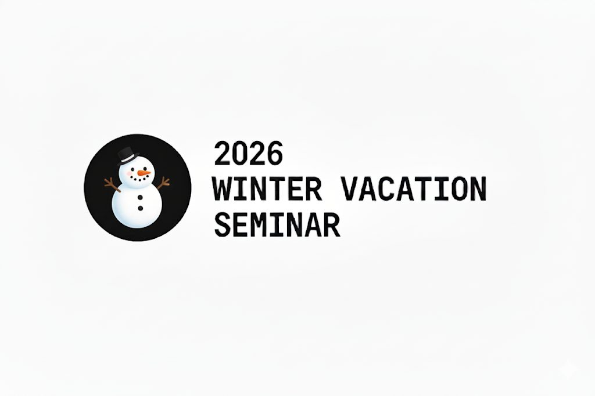

<figure class="board-fig"></figure>

2026-01-09 

**주제: Prompt-controllable Camera Parameters in Image manipulation**

1. Generative Photography: Scene-Consistent Camera Control for Realistic Text-to-Image Synthesis (CVPR 2025 Highlight)

2. Thinking with Camera: A Unified Multimodal Model for Camera-Centric Understanding and Generation (ICLR submitted, Rate: 6,8,8,6)

발표자: [정성훈](/members/shj/)

[📎 \[2026 winter seminar\] 정성훈.pdf](/images/gallery/board/seminar-2026-01-09-2026-winter-vacation-seminar/02.pdf)

**주제 : Exploring 3D foundation models**

1. DUSt3R: Geometric 3D Vision Made Easy \[CVPR 2024\]

2. VGGT: Visual Geometry Grounded Transformer \[CVPR 2025 Best Paper Award\]

발표자: [진인환](/members/inhwan/)

[📎 \[2026 winter seminar\] 진인환.pdf](/images/gallery/board/seminar-2026-01-09-2026-winter-vacation-seminar/03.pdf)

**주제 : Deep Dive into Efficient LLMs: KV Cache Compression**

1. SnapKV: LLM Knows What You are Looking for Before Generatio   \[NeurIPS 2024\]

2. KVzip: Query-Agnostic KV Cache Compression with Context Reconstruction \[NeurIPS 2025 oral\]

발표자: [백창우](/members/changwoo/)

[📎 \[2026 winter seminar\] 백창우.pdf](/images/gallery/board/seminar-2026-01-09-2026-winter-vacation-seminar/04.pdf)

2026-01-15 

**주제 : Agentic Query Refinement for Open-Vocabulary Object Detection**

1. YOLOE: Real-Time Seeing Anything \[ICCV 2025\]

2. Re-Aligning Language to Visual Objects with an Agentic Workflow \[ICLR 2025\]

발표자: [정다운](/members/daun/)

[📎 \[2026 winter seminar\] 정다운.pdf](/images/gallery/board/seminar-2026-01-09-2026-winter-vacation-seminar/05.pdf)

**주제: 3D Representation for Dynamic scenes**

1. FreeTimeGS: Free Gaussian Primitives at Anytime and Anywhere for Dynamic Scene Reconstruction \[CVPR2025\]

2. 4DGT: Learning a 4D Gaussian Transformer Using Real-World Monocular Videos \[NeurIPS2025 Spotlight\]

발표자: [김태훈](/members/taehoon/)

[📎 \[2026 winter seminar\] 김태훈.pdf](/images/gallery/board/seminar-2026-01-09-2026-winter-vacation-seminar/06.pdf)

**주제: Introducing the Meta SAM Family**

1. SAM 3: Segment Anything with Concepts \[arXiv, 2025\]

2. SAM Audio: Segment Anything in Audio \[arXiv, 2025\]

발표자: [박순찬](/members/parksunchan/)

[📎 \[2026 winter seminar\] 박순찬.pdf](https://www.notion.so/2f1abcc90e3480bbae61faf0e257d9cd)

2026-01-23 

**주제 : Controllable Video Generation with Physical Priors**

1. WonderPlay: Dynamic 3D Scene Generation from a Single Image and Actions \[ICCV'25 Highlight\]
2. Force Prompting: Video Generation Models Can Learn and Generalize Physics-based Control Signals \[NeurIPS'25\]

발표자: [문형주](/members/hyeong-ju/)

[📎 \[2026 winter seminar\] 문형주.pdf](/images/gallery/board/seminar-2026-01-09-2026-winter-vacation-seminar/08.pdf)

 **주제: real-to-sim-to-real pipeline for humanoid**

1. Visual Imitation Enables Contextual Humanoid Control (CoRL 2025, Best Student Paper Award.)

발표자: [이우진](/members/woojin/)

[📎 \[2025 summer seminar\] 이우진.pdf](/images/gallery/board/seminar-2026-01-09-2026-winter-vacation-seminar/09.pdf)

**주제 : Object hallucinations in VLM**

1. Devils in Middle Layers of Large Vision-Language Models: Interpreting, Detecting and Mitigating Object Hallucinations via Attention Lens (CVPR 2025)
2. On Epistemic Uncertainty of Visual Tokens for Object Hallucinations in Large Vision-Language Models(NeurIPS 2025)

발표자: [김소현](/members/sohyeon/)

[📎 \[2026 winter seminar\] 김소현.pdf](/images/gallery/board/seminar-2026-01-09-2026-winter-vacation-seminar/10.pdf)

2026-01-29 

**주제:  A Unified Feedforward Framework for Scene and Human Understanding**

 1. Continuous 3D Perception Model with Persistent State (CVPR 2025 Oral)

 2. Human3R: Everyone Everywhere All at Once (ICLR 2026 submitted, Rate: 8, 8, 4)

[📎 \[2026 winter seminar\] 최지훈.pdf](/images/gallery/board/seminar-2026-01-09-2026-winter-vacation-seminar/11.pdf)

발표자: [최지훈](/members/jihoon/)

**주제: 딥러닝 기초 및 실습 코드**

[📎 \[2026 winter seminar\] 윤지원.pdf](/images/gallery/board/seminar-2026-01-09-2026-winter-vacation-seminar/12.pdf)

발표자: [윤지원](/members/jiwon/)

**주제: 딥러닝 기초 및 실습 코드**

[📎 \[2026 winter seminar\] 조범권.pdf](/images/gallery/board/seminar-2026-01-09-2026-winter-vacation-seminar/13.pdf)

발표자: [조범권](/members/beomgwon/)

2026-02-12 

**주제:  Physics-Grounded Video Generation**

1. PhysGen3D: Crafting a Miniature Interactive World from a Single Image (CVPR 2025)
2. PhysCtrl: Generative Physics for Controllable and Physics-Grounded Video Generation (NeurIPS 2025)

   [📎 \[2026 winter seminar\] 김소형.pdf](/images/gallery/board/seminar-2026-01-09-2026-winter-vacation-seminar/14.pdf)

발표자: [김소형](/members/sohyeong/)

**주제: 딥러닝 기초 및 실습 코드**

[📎 \[2026 winter seminar\] 김우형.pdf](/images/gallery/board/seminar-2026-01-09-2026-winter-vacation-seminar/15.pdf)

발표자: [김우형](/members/woohyeong/)

**주제: 딥러닝 기초 및 실습 코드**

[📎 \[2026 winter seminar\] 윤상연.pdf](/images/gallery/board/seminar-2026-01-09-2026-winter-vacation-seminar/16.pdf)

발표자: [윤상연](/members/sang-yeon/)

2026-04-03 

**주제: 딥러닝 기초 및 실습 코드**

[📎 \[2026 spring seminar\] 김준수.pdf](/images/gallery/board/seminar-2026-01-09-2026-winter-vacation-seminar/17.pdf)

발표자: [김준수](/members/junsu/)
