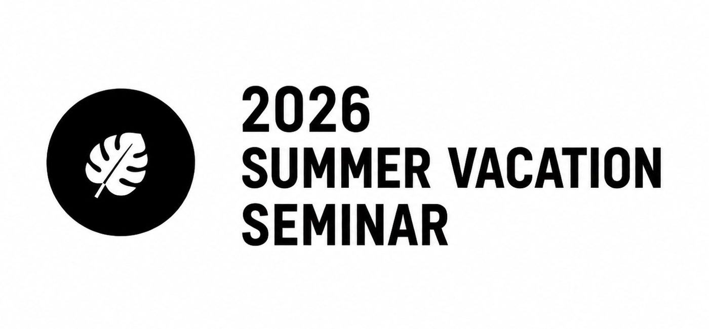

<figure class="board-fig"></figure>

2026-08-08  

**주제: Learning Manufacturing Know-How from CAD Data: Building VLM Datasets for the Factory Floor**

1.   [CADFS: A Big CAD Program Dataset and Framework for Computer-Aided Design with Large Language Models](https://arxiv.org/pdf/2605.01925) \[CVPR 2026\]

발표자: [정성훈](/members/shj/)

[📎 \[2026 summer seminar\] 정성훈.pdf](/images/gallery/board/seminar-2026-08-10-2026-summer-vacation-seminar/02.pdf)

주제: Efficient Agentic Systems through Tool Orchestration and Latent Collaboration

1. [Latent Collaboration in Multi-Agent Systems](https://arxiv.org/pdf/2511.20639) \[ICML 2026 Spotlight\]
2. [ToolOrchestra: Elevating Intelligence via Efficient Model and Tool Orchestration](https://arxiv.org/pdf/2511.21689) \[ICML 2026\]

발표자: [<u>윤상연</u>](/members/sang-yeon/)

[📎 \[2026 summer seminar\] 윤상연.pdf](/images/gallery/board/seminar-2026-08-10-2026-summer-vacation-seminar/03.pdf)

2026-08-14  

주제: Towards Explicit 3D Representation: Mesh Reconstruction for Static and Dynamic Scenes

1. [MeshSplatting: Differentiable Rendering with Opaque Meshes](https://arxiv.org/pdf/2512.06818) \[CVPR 2026\]
2. [Dynamic Gaussians Mesh: Consistent Mesh Reconstruction from Dynamic Scenes](https://arxiv.org/pdf/2404.12379) \[ICLR 2025\]

발표자: [김태훈](/members/taehoon/)

[📎 \[2026 summer seminar\] 김태훈.pdf](/images/gallery/board/seminar-2026-08-10-2026-summer-vacation-seminar/04.pdf)

주제: Integrating Video Diffusion into 4D Scene Modeling

1. [SparseCam4D: Spatio-Temporally Consistent 4D Reconstruction from Sparse Cameras](https://arxiv.org/pdf/2603.26481) \[CVPR 2026\]
2. [Diff4Splat: Controllable 4D Scene Generation with Latent Dynamic Reconstruction Models](https://arxiv.org/pdf/2511.00503) \[CVPR 2026\]

발표자: [최지훈](/members/jihoon/)

[📎 \[2026 summer seminar\] 최지훈.pdf](/images/gallery/board/seminar-2026-08-10-2026-summer-vacation-seminar/05.pdf)

2026-08-20

주제: Physics-Guided Dynamic World Generation through Hybrid Generative Simulation

1. [WonderPlay: Dynamic 3D Scene Generation from a Single Image and Actions](https://arxiv.org/pdf/2505.18151) \[ICCV 2025 Highlight\]
2. [PerpetualWonder: Long-Horizon Action-Conditioned 4D Scene Generation](https://arxiv.org/pdf/2602.04876) \[CVPR 2026 Highlight\]

발표자: [김우형](/members/woohyeong/)

[📎 \[2026 summer seminar\] 김우형.pdf](/images/gallery/board/seminar-2026-08-10-2026-summer-vacation-seminar/06.pdf)

주제: Counterfactual Reasoning: Theory and Applications

1. [Reasoning with cause and effect](https://www.ijcai.org/Proceedings/99-2/Papers/108.pdf) \[AAAI 2002\]
2. [Should I Have Expressed a Different Intent? Counterfactual Generation for LLM-Based Autonomous Control](http://arxiv.org/pdf/2601.20090) \[ICML 2026\]

발표자: [김소형](/members/sohyeong/)

[📎 \[2026 summer seminar 김소형\].pdf](/images/gallery/board/seminar-2026-08-10-2026-summer-vacation-seminar/07.pdf)

2026-08-28

주제: Efficient Token Compression for Omnimodal Large Language Models

1. [OmniZip: Audio-Guided Dynamic Token Compression for Fast Omnimodal Large Language Models](https://arxiv.org/pdf/2511.14582) \[CVPR 2026\]
2. [OmniFit: Bridging Modalities via Layer-Adaptive Token Compression for Omnimodal Large Language Models](https://openreview.net/pdf?id=8RY20mLzup) \[ICML 2026 spotlight\]

발표자: [조범권](/members/beomgwon/)

[📎 \[2026 summer seminar 조범권\].pdf](/images/gallery/board/seminar-2026-08-10-2026-summer-vacation-seminar/08.pdf)

주제: Optimizing Texts for an Open-Vocabulary: From Iterative LLM Feedback to Vocabulary-Aware Fine-Tuning

1. [LLMs can see and hear without any training \[ICML 2025\]](https://arxiv.org/pdf/2501.18096)
2. [Vocabulary Scaling Law: Tuning Open-vocabulary Predictors for Their Openness \[CVPR 2026\]](https://openaccess.thecvf.com/content/CVPR2026/papers/Chen_Vocabulary_Scaling_Law_Tuning_Open-vocabulary_Predictors_for_Their_Openness_CVPR_2026_paper.pdf)

발표자: [김준수](/members/junsu/)

[📎 \[2026 summer seminar 김준수\].pdf](/images/gallery/board/seminar-2026-08-10-2026-summer-vacation-seminar/09.pdf)
