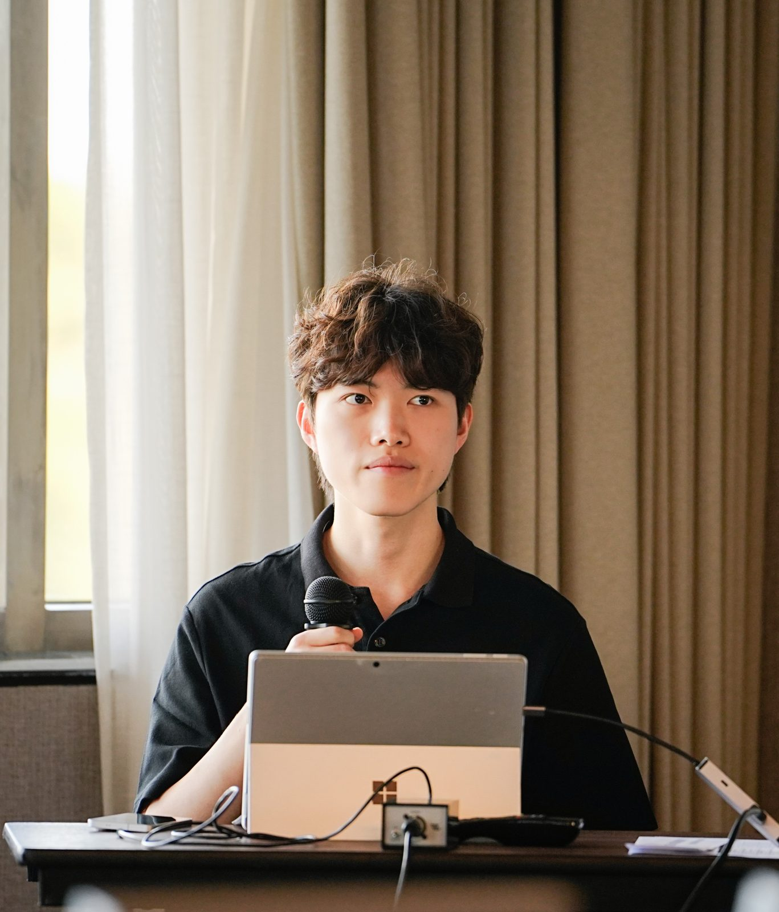

Integrated BS-MS  Course

<figure class="board-fig"></figure>

## Beomkwon Cho

<code>chobk1@pusan.ac.kr</code>

## Research Interests

- Multimodal AI
- Audio-Visual Perception

## **Publication**

**(\*equally contributed, †corresponding author)**

### **International Conference Papers**

**\[C2\] Compositional Agentic Formulation Search for Open-Vocabulary Audio-Visual Event Localization Beomkwon Cho**\*, Sunchan Park\*, Kyeongbo Kong† ICMLW, 2026. (Top-tier AI conference workshop)

**\[C1\] Video-Conditioned Hyperparameter Prediction for Audio-Visual Event Localization Beomkwon Cho**\*, Sunchan Park\*, Kyeongbo Kong† ITC-CSCC**,** 2026.

### **Domestic Conference Papers**

**\[C1\] Open-Vocabulary Audio-Visual Event Localization을 위한 Agentic Decision-Rule 탐색 프레임워크 조범권**\*, 박순찬\*, 공경보† 대한전자공학회 하계학술대회**,** 2026.

## **Project**

홈로봇 객체 변화 기반 공간 정돈도 감지 기술 개발, LG전자, 참여연구원 (May 2026 ~ Nov. 2026)
