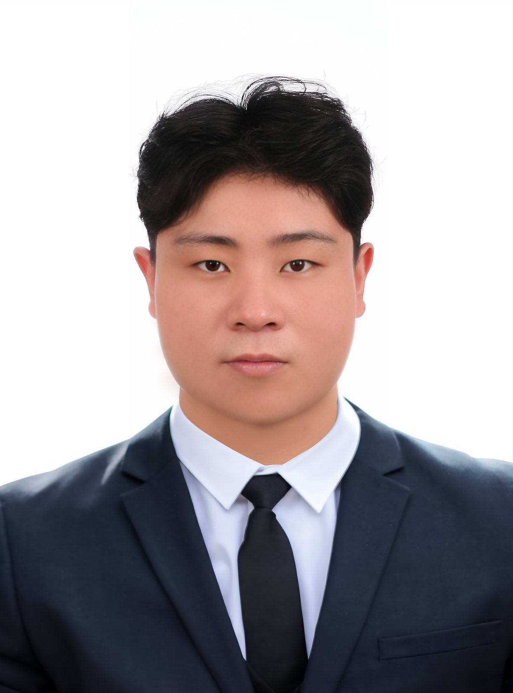

Integrated BS-MS  Course

<figure class="board-fig"></figure>

## Changwoo Baek 

higok18@pusan.ac.kr

**🌐**[**Personal homepage**](https://sites.google.com/view/changwoobaek00/%ED%99%88)

## Research Interests

- Efficient AI
- CV & NLP & Robotics

## Publication

**(\*equally contributed, †corresponding author)**

### **Preprint**

**\[P1\] Changwoo Baek**, Seungjun Shin†, Kyeongbo Kong†**,** “RestoreKV: Recovering Full-Cache Behavior Under Aggressive Query-Agnostic KV Cache Eviction”, **2026. 08.**  [**\[Project page\]**](https://paper.pnu-cvsp.com/RestoreKV/)

**Rank #1 NVIDIA KVPress Leaderboard \[**[**page**](https://huggingface.co/spaces/nvidia/kvpress-leaderboard)**\]**

### **International Conference Papers**

**\[C2\] Changwoo Baek**, Kyeongbo Kong†**,** “3DZip: Spatial-Aware Feature Diversity-Guided Token Compression for 3D Question Answering”, ***ECCV*****, 2026.**  [**\[Project page\]**](https://github.com/cvsp-lab/3DZip) [**\[Code\]**](https://github.com/cvsp-lab/3DZip)

**\[C1\] Changwoo Baek\***, Jouwon Song\*, Sohyeon Kim\*, Kyeongbo Kong†**,** “AgilePruner: An Empirical Study of Attention and Diversity for Adaptive Visual Token Pruning in Large Vision-Language Models”, ***ICLR***, 2026.                

### **International Journal Papers**

**\[J2\]** **Changwoo Baek\***, Taehoon Kim\*, Woojin Lee\*, Jungkwan Son, Seoyoung Lee, Jiyoung Kim, Kyeongbo Kong†**,** “Target-Aware Change Detection for Efficient VLM Gating in Mobile Robots”, ***IEEE Robotics and Automation Letters*** *(****RA-L****),* 2026*.*

**\[J1\]** **Changwoo Baek**, Jou Won Song, Kyeongbo Kong† **, “**Unsupervised Knowledge Distillation via Local Representations for Vision-Language Models”, ***IEEE Signal Processing Letters***, 2025.

### **International Workshop Papers**

**\[W1\] Changwoo Baek,** Kyeongbo Kong†**,** “HYBRIDKV: Exploiting Head-Dominant Reconstruction for Efficient Query-Agnostic KV Cache Compression”, ***ICML Workshop AdaptFM***, 2026.           

### **Domestic Journal Papers**

**\[J2\] 멀티모달 LLM에서의 비전 인코더 계층별 엔트로피 변화를 활용한 시각 토큰 프루닝** **백창우****\***, 김소현\*, 송주원\*, 백광렬, 공경보†, 방송공학회논문지, 2026.

**\[J1\] 딥러닝 기반 저조도 향상 기술을 활용한 얼굴 인식 성능 개선** **백창우****,** 공경보†, 대한임베디드공학회논문지, 2024.

## **Project**

- 홈로봇 환경을 고려한 야간 사람 인식 기술 개발 및 주간 얼굴 인식 성능 개선, LG Electronics, Korea /공동연구원 /23.12~24.12
- 홈로봇 환경을 고려한 VLM 기반시각 인식 기술 개발 및 상황 인지·추론 성능 개선, LG Electronics, Korea /공동연구원 / 25.5~
- 홈로봇 이상 상황 환경 감지 기술 개발, LG Electronics, Korea /공동연구원/ 25.7~

## Academic Service

- Conferences: NeruIPS’26, ICLR’27
- Journals: IEEE TPAMI, IEEE TIP
