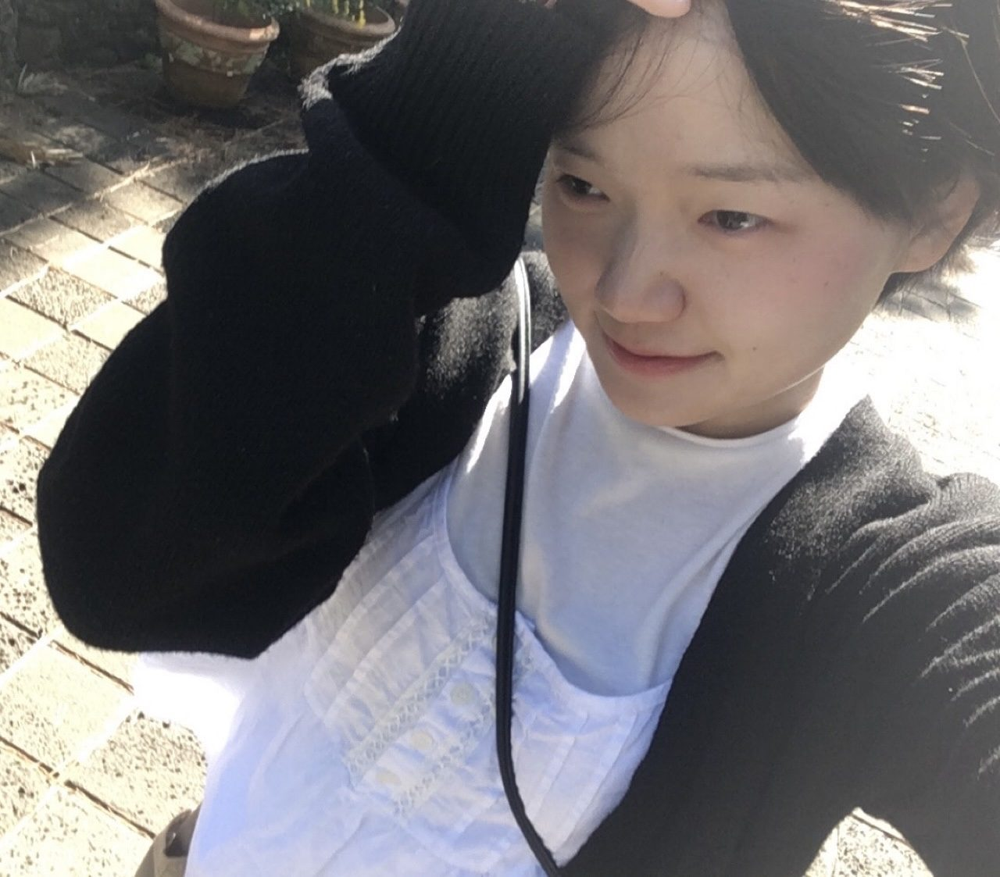

Research Intern

<figure class="board-fig"></figure>

## **Haesoo Choo**

[<code>tndi28@naver.com</code>](mailto:tndi28@naver.com)

## Alumni

- NAVER WEBTOON

## **Publication**

**(\* indicates first author, † indicates corresponding author)**

### International Journal Papers

**\[J1\] Motion-to-Attention: Enhancing Attention Maps to Improve Performance of Text-Guided Video Editing**

Seong-Hun Jeong\*, In-Hwan Jin\*, **Haesoo Choo\***, Hyeonjun Na\*, Kyeongbo Kong†

**ACM Transactions on Multimedia Computing, Communications, and Applications (ACM TOMM)** (IF: 6.0, JCR 7.8%)

[<code>Project Page</code>](https://currycurry915.github.io/Motion-to-Attention/)  [<code>Code</code>](https://github.com/currycurry915/ACMTOMM_M2A) 

### **International Conference Papers**

**\[C4\] Optimizing 4D Gaussians for Dynamic Scene Video from Single Landscape Images** In-Hwan Jin\*, **Haesoo Choo\***, Seong-Hun Jeong, Heemoon Park, Junghwan Kim, Oh-joon Kwon, Kyeongbo Kong†

**ICLR** 2025, Apr, 2025  (Top-tier AI conference, Acceptance Rate: 32.08%)

**\[C3\] Dynamic Scene Reconstruction from Single Landscape Image Using 4D Gaussian in the Wild**

In-Hwan Jin\*, **Haesoo Choo\***, Seong-Hun Jeong**,** Heemoon Park, Junghwan Kim, Oh-joon Kwon, Kyeongbo Kong†

**ECCVW** 2024, Sep, 2024

**\[C2\]4D Gaussian Splatting for Multi-view 3D Cinemagraphy**

In-Hwan Jin\*, **Haesoo Choo\***,  Kyeongbo Kong†

**IMID** 2024 **(Invited)**

**\[C1\] Enhancing Text-to-Video Editing with Motion Map Injection** Seong-Hun Jeong\*, Inhwan Jin\*, **Haesoo Choo\***, Hyunjun Na\*, Kyeongbo Kong**†**

**ICCVW***,* Oct. 2023. (Top-tier AI conference workshop) **(Oral Presentation Invitation)**

### **Domestic Conference Papers**

**\[C3\] 단일 이미지 기반 4차원 동적 장면 생성 프레임워크 구현**

**추해수\***, 진인환\*, 공경보† 대한임베디드공학회 ICT 대학생 논문 경진대회, June 2025. **(장려상)**

**\[C2\] 단일 풍경 이미지의 Dynamic Scene Video 생성을 위한 4D Gaussian Splatting 최적화 알고리즘 구현**

진인환\*, **추해수\***, 정성훈, 공경보† 제34회 인공지능신호처리 학술대회, Oct. 2024.

**\[C1\] Optical Flow의 방향 정보를 활용한 Text-to-Video 편집 기술** 정성훈\*, 진인환, **추해수**, 공경보† 대한임베디드공학회 ICT 대학생 논문 경진대회, Jul. 2024. **(장려상)**

### **Domestic Journal Papers**

**\[J1\] 버추얼 프로덕션을 위한 딥러닝 기반 2.5D 에셋 생성 기술 연구** 

**추해수\***, 진인환, 정성훈, 김정환†, 공경보†

 방송공학회논문지, 2024년 11월.

## Projects

### 방송문화진흥회

- 생성형 AI를 활용한 실감형 해양콘텐츠 제작 체계 개발, 부산MBC, Korea/ 참여연구원(Jul.2023 ~ Nov. 2024)

## Patents

- 공경보, 진인환, **추해수**, 정성훈, "4차원 모델 정보의 생성 방법 및 장치", 출원일자: 2024년 9월 13일, 출원번호: 10-2024-0125265, 부산대학교 산학협력단

