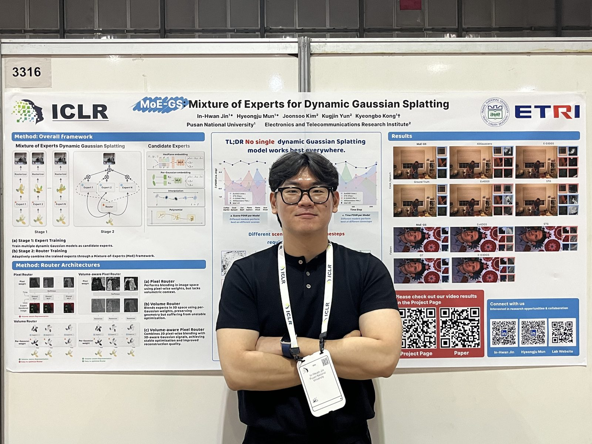

M.S. Course

<figure class="board-fig"></figure>

## **In-Hwan Jin**

[Personal Page](https://inhwanjin.github.io/)

## Research Interests

- Physically Grounded Representation
- 3D/4D World Modeling

## Publication

**(\* indicates first author, † indicates corresponding author)**

### **Submitted**

**\[S1\] Anonymized Title** Jihoon Choi\*, **In-Hwan Jin\***, Joonsoo Kim, Kugjin Yun, Kyeongbo Kong†

**\[S2\] Anonymized Title** Sohyeong Kim\*, Woo Hyeong Kim\*, **In-Hwan Jin\***, Joonsoo Kim, Kugjin Yun, Kyeongbo Kong†

### **International Conference Papers**

**\[C9\] Counterfactual Simulation-Guided Physical Reasoning for Physics-Based Video Generation** Sohyeong Kim\*, Woo Hyeong Kim\*, **In-Hwan Jin\***, Hyeongju Mun, Kyeongbo Kong† **ECCVW,** 2025. (Top-tier AI conference workshop) [<code>Paper</code>](https://eccv2026-3d-world-models.github.io/papers/files/25-counterfactual-simulation-guided-physical-reasoning-for-physics-based-video-gene.pdf)  [<code>Project Page</code>](https://annon-repo-for-science.github.io/CounterFactual/)  

**\[C8\] LivingWorld: Interactive 4D World Generation with Environmental Dynamics** Hyeongju Mun\*, **In-Hwan Jin\***, Sohyeong Kim, Kyeongbo Kong† **ECCV**, 2026. (**Top-tier AI Conference, Acceptance Rate: 27.5%**; Also presented at the MUSTCV Workshop) [<code>Paper</code>](https://arxiv.org/pdf/2604.01641)  [<code>Project Page</code>](https://paper.pnu-cvsp.com/LivingWorld/)  

**\[C7\] MoE-GS: Mixture of Experts for Dynamic Gaussian Splatting** **In-Hwan Jin**\*, Hyeongju Mun\*, Joonsoo Kim, Kugjin Yun, Kyeongbo Kong† **ICLR,** 2026.  **(Top-tier AI conference, Acceptance Rate: 28%)**  [<code>Paper</code>](https://arxiv.org/pdf/2510.19210)  [<code>Project Page</code>](https://paper.pnu-cvsp.com/MoE-GS/)  [<code>Code</code>](https://github.com/cvsp-lab/ICLR2025_3D-MOM)      

**\[C6\] FluIDWorld: Fluid-like Interactive Dynamics for 4D Worlds** Hyeongju Mun\*, **In-Hwan Jin\***, Sohyeong Kim, Kyeongbo Kong† **ICLRW,** 2025. (Top-tier AI conference workshop)

**\[C5\] Generating 3D Gaussian Motion Fields for Dynamic Scene Video from Single Image** Sohyeong Kim\*, Hyeongju Mun\*, **In-Hwan Jin\***, Kyeongbo Kong† **ICEIC,** 2026.

**\[C4\] Optimizing 4D Gaussians for Dynamic Scene Video from Single Landscape Images**  **In-Hwan Jin\***, Haesoo Choo\*, Seong-Hun Jeong, Heemoon Park, Junghwan Kim, Oh-joon Kwon, Kyeongbo Kong† **ICLR,** 2025.  **(Top-tier AI conference, Acceptance Rate: 32.08%)** [<code>Paper</code>](https://arxiv.org/pdf/2504.05458)  [<code>Project Page</code>](https://paper.pnu-cvsp.com/ICLR2025_3D-MOM/)  [<code>Code</code>](https://github.com/cvsp-lab/ICLR2025_3D-MOM)      

**\[C3\] Dynamic Scene Reconstruction from Single Landscape Image Using 4D Gaussian in the Wild** **In-Hwan Jin\***, Haesoo Choo\*, Seong-Hun Jeong**,** Heemoon Park, Junghwan Kim, Oh-joon Kwon, Kyeongbo Kong† **ECCVW,** 2024.   (Top-tier AI conference workshop) [<code>Paper</code>](https://openreview.net/pdf?id=HrwrydyPBD)  [<code>Project Page</code>](https://cvsp-lab.github.io/3D_MRM_page/)    

**\[C1\] Enhancing Text-to-Video Editing with Motion Map Injection**  Seong-Hun Jeong\*, **In-Hwan Jin\***, Haesoo Choo\*, Hyunjun Na\*, Kyeongbo Kong† **ICCVW,** 2023. (Top-tier AI conference workshop) **(Oral Presentation Invitation)** [<code>Paper</code>](https://currycurry915.github.io/MMI/static/pdfs/ICCVw2023_motion_main_paper.pdf)  [<code>Project Page</code>](https://currycurry915.github.io/MMI/)    [<code>Code</code>](https://github.com/currycurry915/Motion_Map_Injection)      

### International Journal Papers

**\[J2\]** **On the Design of Mixture-of-Experts for Dynamic Gaussian Splatting**  **In-Hwan Jin\***, Hyeongju Mun\*, Joonsoo Kim, Kugjin Yun, Kyeongbo Kong† ***IEEE Transactions on Pattern Analysis and Machine Intelligence (TPAMI)***, **2026.** (IF: 20.4, JCR top 0.9%)

[<code>Paper</code>](https://ieeexplore.ieee.org/document/11606163)  [<code>Arxiv</code>](https://arxiv.org/pdf/2607.08250)  [<code>Project Page</code>](https://github.com/cvsp-lab/MoE-GS-studio)    [<code>Code</code>](https://github.com/cvsp-lab/MoDE)  

**\[J1\] Motion-to-Attention: Enhancing Attention Maps to Improve Performance of Text-Guided Video Editing** Seong-Hun Jeong\*, **Inhwan Jin\*,** Haesoo Choo\*, Hyunjun Na\*, Kyeongbo Kong† ***ACM Transactions on Multimedia Computing, Communications, and Applications,*** **2026*****.***  (IF: 6.0, JCR 7.8%) [<code>Project Page</code>](https://currycurry915.github.io/Motion-to-Attention/)    [<code>Code</code>](https://github.com/currycurry915/ACMTOMM_M2A)  

### **Domestic Conference Papers**

**\[C4\] LLM-VLM 통합 기반 파노라마 장면 편집 및 일관성 평가 자동화 프레임워크** 김민주\*, 유가연\*, 강성민\*, **진인환**, 문형주, 공경보†  방송미디어공학회 동계학술대회 대학생 논문 경진대회, Dec 2025. **(최우수상)**

**\[C3\] 단일 이미지 기반 4차원 동적 장면 생성 프레임워크 구현** 추해수\*, **진인환\***, 공경보†  대한임베디드공학회 ICT 대학생 논문 경진대회, June 2025. **(장려상)**

**\[C2\] 단일 풍경 이미지의 Dynamic Scene Video 생성을 위한 4D Gaussian Splatting 최적화 알고리즘 구현** **진인환**\*, 추해수\*, 정성훈, 공경보† 제34회 인공지능신호처리 학술대회, Oct. 2024.

**\[C1\] Optical Flow의 방향 정보를 활용한 Text-to-Video 편집 기술** 정성훈\*, **진인환**, 추해수, 공경보†  대한임베디드공학회 ICT 대학생 논문 경진대회, Jul. 2024. **(장려상)**

**\[J2\] 동적 이미지 합성을 위한 4D Gaussian Splatting 기법 비교 및 연구 동향** 우민수\***, 진인환\*,** 김준수, 윤국진, 공경보† 방송공학회논문지, 2025년 1월.

**\[J1\] 버추얼 프로덕션을 위한 딥러닝 기반 2.5D 에셋 생성 기술 연구**  추해수\*, **진인환**, 정성훈, 김정환†, 공경보† 방송공학회논문지, 2024년 11월.

## Projects

### ETRI

- 고품질 가상시점 합성을 위한 4D 가우시안 표현 학습 및 시점 증강 SW 구현   , ETRI, Korea/ 참여연구원(Mar. 2026 ~ )
- 라이트필드 비디오 데이터 생성을 위한 다시점 영상 기반 고품질 4D 공간 복원 SW 구현, ETRI, Korea/ 참여연구원(Mar. 2025 ~ Nov. 2025)
- 4D 공간표현 생성 및 라이트필드 비디오 렌더링 SW 구현, ETRI, Korea/ 참여연구원 (Aug. 2024 ~ Nov. 2024)

### 방송문화진흥회

- 생성형 AI를 활용한 실감형 해양콘텐츠 제작 체계 개발, 부산MBC, Korea/ 참여연구원(Jul.2023 ~ Nov. 2024)

## **Technical Academic Activities**

- Reviewer of ICLR (2027)
- Reviewer of NeurIPS (2026)

## Patents

- 공경보, **진인환**, 추해수, 정성훈, "4차원 모델 정보의 생성 방법 및 장치", 출원일자: 2024년 9월 13일, 출원번호: 10-2024-0125265, 부산대학교 산학협력단 (기술이전)
- 공경보, **진인환**, 문형주, 김준수, 윤국진, 이진환, 추현곤, "다중 가우시안 모델 기반 가상시점 렌더링 방법", 한국전자통신연구원
- 공경보, **진인환**, 문형주, 김소형, "단일 이미지로부터 4D 장면을 생성하는 방법 및 장치", 출원일자: 2026년 1월 8일, 출원번호: 10-2026-0003755, 부산대학교 산학협력단 (기술이전)

## Education Programs

- **University of Toronto AI 융합 교육프로그램 파견교육생,** 2027 1월-6월
- **POSCO AI/Big Data Academy** (27기), 2024년 7월 - 9월 (***협력상****-같이 일하고싶은 동료 투표 결과)*
