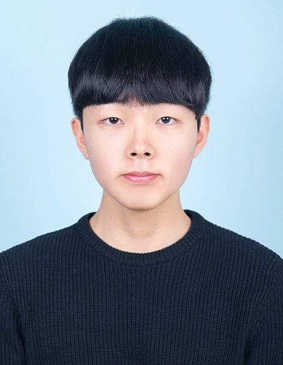

Integrated BS-MS  Course

<figure class="board-fig"></figure>

## Jihoon Choi

[chlwlgns0101@pusan.ac.kr](mailto:chlwlgns0101@pusan.ac.kr)

## Research Interests

- Computer Vision
- 3D/4D World Reconstruction
  - Gaussian Splatting
  - Human Reconstruction

## **Publication**

### **Submitted**

**\[S1\] Anonymized Title Jihoon Choi\***, In-Hwan Jin\*, Joonsoo Kim, Kugjin Yun, Kyeongbo Kong†

### **International Conference Papers**

**\[C1\] Sparse-View Dynamic Scene Reconstruction with 4D Gaussian Splatting Jihoon Choi\***, Kyeongbo Kong† **ICEIC,** 2027.

### **Domestic Conference Papers**

**\[C1\] 단안 비디오 기반 인간-공간 통합형 3D 글로벌 모션 복원 기술 동향**  **최지훈\***, 진인환\*, 공경보† 대한전자공학회 하계학술대회, June.2026.

## Projects

### ETRI

- 고품질 가상시점 합성을 위한 4D 가우시안 표현 학습 및 시점 증강 SW 구현   , ETRI, Korea/ 참여연구원(Mar. 2026 ~ )
