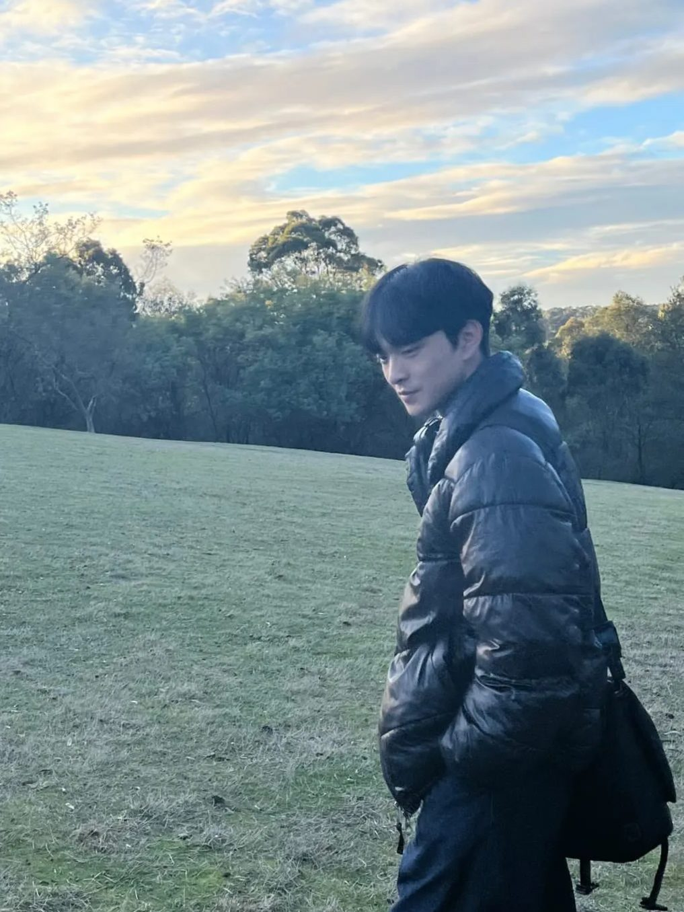

Integrated BS-MS  Course

<figure class="board-fig"></figure>

## Junsu Kim

<code>wave2503@pusan.ac.kr</code>

## Research Interests

- Multimodal AI
- Audio-Visual Understanding

## **Publication**

### **Domestic Conference Papers**

**\[C1\] 최신 V2A 연구 동향: 제어성, 충실도, 공간감**  **김준수\***, 박순찬, 공경보†  대한전자공학회 하계학술대회, June.2026.
