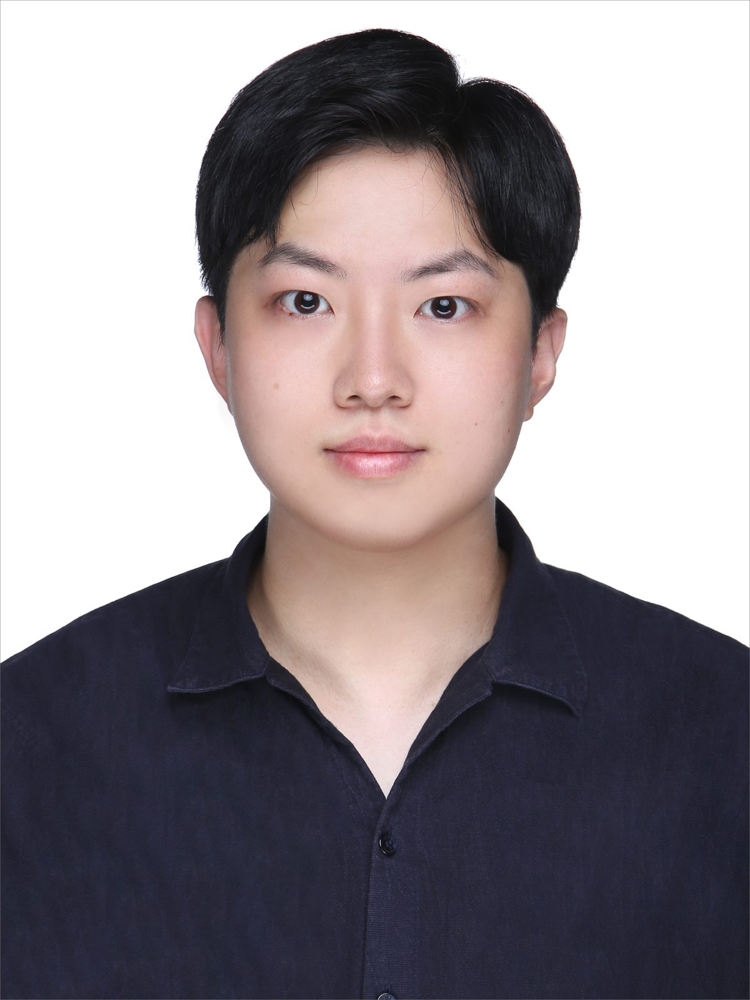

Professor

<figure class="board-fig"></figure>

## **Kyeongbo Kong**

<code>kbkong@pusan.ac.kr</code>

<code>kkb4723@gmail.com</code>

## **Professional Experience**

- **Associate professor** 

  Department of Electronics Engineering at **Pusan National University**, *Sep. 2025 – Present*

- **Assistant professor** 

  Department of Electronics Engineering at **Pusan National University**, *Sep. 2023 – Aug. 2025*

  Department of Human ICT at **Pukyong National University**, *Sep. 2021 – Aug. 2023*

- **Postdoctoral researcher** 

  Department of Electrical Engineering at **POSTECH**, *Sep. 2020 – Aug. 2021*

## **Education**

- **Ph.D.** Department of Electrical Engineering at **POSTECH**, *Mar. 2017 – Aug. 2020*
- **M.S.** Department of Electrical Engineering at **POSTECH**, *Mar. 2015 – Feb. 2017*
- **B.S.** Department of Electronic Engineering at **Sogang University** (Summa cum laude), *Mar. 2009 – Feb. 2015*

## **Publications**

(\* indicates first author, † indicates corresponding author)

### <u>2026@PNU</u>

- **International Journals**
  1. Gyung Mo Son\*†, In Young Lee, Seojeong Park, Sang-Ho Park, **Kyeongbo Kong**, Kwang-Ryul Baek, “Indocyanine Green Fluorescence Angiography in Colorectal Cancer Surgery after a Decade of Randomized Trials: From Visual Assessment to Quantification and Beyond”, Cancers, 2026.
  2. **\[JCR Q2 · IF 5.3\]** Dongkyu Kim\*, Eunho Shin\*, **Kyeongbo Kong†**, Suk-Ju Kang†, “RoAD: Robust Adaptive Domain-Aware Visual Place Recognition with Dynamic Architecture”, *IEEE Robotics and Automation Letters (RA-L),* 2026*.*
  3. **\[JCR Top 3.4% · IF 10.8\]** Yubin Cho\*, Hyunwoo Yu\*, **Kyeongbo Kong\***, Kyomin Sohn, Bongjoon Hyun and Suk-Ju Kang†, “VIPA: Visual Informative Part Attention for Referring Image Segmentation”, *IEEE Transactions on Circuits and Systems for Video Technology,* 2026*.*
  4. **\[JCR Q2 · IF 3.6\]** Seungjun Shin\*, **Kyeongbo Kong†**,  “Hidden-State-Relative Actuator Bounds for PID-Style Activation Steering in Language Models”, *IEEE Signal Processing Letters*, 2026.
  5. **\[JCR Top 0.9% · IF 20.4\]** In-Hwan Jin\*, Hyeongju Mun\*, Joonsoo Kim, Kugjin Yun, **Kyeongbo Kong†**, “On the Design of Mixture-of-Experts for Dynamic Gaussian Splatting”, *IEEE Transactions on Pattern Analysis and Machine Intelligence,* 2026*.*
  6. **\[JCR Q2 · IF 3.6\]** Sunchan Park\*, Hyung Soon Kim, **Kyeongbo Kong†,** “Group-wise Layer Aggregation of Self-Supervised Representations for Speech Emotion Recognition”, *IEEE Signal Processing Letters*, 2026.
  7. **\[JCR Q2 · IF 5.3\]** Changwoo Baek\*, Taehoon Kim\*, Woojin Lee\*, Jungkwan Son, Seoyoung Lee, Jiyoung Kim, **Kyeongbo Kong†,** “Target-Aware Change Detection for Efficient VLM Gating in Mobile Robots”, *IEEE Robotics and Automation Letters (RA-L),* 2026 **(ICRA 2027 Presentation)***.*
  8. **\[JCR Q1 · IF 5.6\]** Seong-Hun Jeong\*, Inhwan Jin\*, Haesoo Choo\*, Hyunjun Na\*, **Kyeongbo Kong†**, “Motion-to-Attention: Enhancing Attention Maps to Improve Performance of Text-Guided Video Editing”, *ACM Transactions on Multimedia Computing, Communications, and Applications,* 2026*.*
  9. **\[JCR Top 3.4% · IF 10.8\]** Minseok Kang\*, Jihyun Kim\*, ChangHee Yang\*, **Kyeongbo Kong**\*, Suk-Ju Kang†, “Realistic Human Image Animation with Dynamic Camera Effects”, *IEEE Transactions on Circuits and Systems for Video Technology,* 2026*.*
  10. **\[JCR Q3 · IF 2.0\]** Joonsoo Kim\*, Kugjin Yun, Hyon-Gon Choo, Hyeongju Mun, **Kyeongbo Kong**, “3D Gaussian rasterization for rendering of view-multiplexed image for multiview displays“, *ETRI Journal*, 2026.
- **International Conferences**
  1. **\[ML Top-tier\]** Sohyeon Kim\*, Sang Yeon Yoon, **Kyeongbo Kong†**, “Focus Matters: Attention-Value Dynamics for Hallucination Mitigation in Vision-Language Models”, **NeurIPS**, 2026.
  2. **\[CV Top-tier\]** Hyeongju Mun\*, In-Hwan Jin\*, Sohyeong Kim, **Kyeongbo Kong†**, “LivingWorld: Interactive 4D World Generation with Environmental Dynamics”, **ECCV**, 2026.
  3. **\[CV Top-tier\]** Suwoong Yeom\*, Joonsik Nam\*, Seunggyu Choi\*, Lucas Yunkyu Lee, Sangmin Kim, Jaesik Park, Joonsoo Kim, Kugjin Yun, **Kyeongbo Kong†**, Suk-Ju Kang†**,** “TRiGS: Temporal Rigid-Body Motion for Scalable 4D Gaussian Splatting”, **ECCV**, 2026.  
  4. **\[CV Top-tier\]** Changwoo Baek\*, **Kyeongbo Kong†,** “3DZip: Spatial-Aware Feature Diversity-Guided Token Compression for 3D Question Answering”, **ECCV**, 2026.  
  5. **\[CV Top-tier\]** Jouwon Song\*, Woohyeong Kim, **Kyeongbo Kong†**,  “Structured Redundancy Modeling for Efficient Visual Token Pruning in High-Resolution MLLMs”, **ECCV**, 2026.  
  6. **\[ML Top-tier\]** Taekoan Yoo\*, Wonkyung Jung\*, Kyunghun Kim\*, **Kyeongbo Kong†,** “PADS-TAL: Padding-Annealed Diffusion Sampling in Text-Aware Latent Space for Robust and Diverse Text-to-Music Generation”, **ICML**, 2026.
  7. **\[CV Top-tier\]** Jouwon Song\*, Sohyeon Kim\*, **Kyeongbo Kong†,** “Uncertainty-Guided Graph Formulation via MWIS for Token Pruning in LVLMs”, **CVPR Findings**, 2026.
  8. **\[ML Top-tier\]** Changwoo Baek\*, Jouwon Song\*, Sohyeon Kim\*, **Kyeongbo Kong†,** “AgilePruner: An Empirical Study of Attention and Diversity for Adaptive Visual Token Pruning in Large Vision-Language Models”, **ICLR**, 2026.
  9. **\[ML Top-tier\]** In-Hwan Jin\*, Hyeongju Mun\*, Joonsoo Kim, Kugjin Yun, **Kyeongbo Kong†**, “MoE-GS: Mixture of Experts for Dynamic Gaussian Splatting”, **ICLR**, 2026.

  

**Workshop Papers**

  

  

**Other Conference Papers**

  

### <u>2025@PNU</u>

- **International Journals**
  1. **\[JCR Q3 · IF 2.0\]** Jou Won Song\*, **Kyeongbo Kong\***, Ye In Park, Seong-Gyun Kim, Suk-Ju Kang†, "Self-Supervised Anomaly Segmentation for Surface Defect Inspection in Display Panels", *Journal of the Society for Information Display*, 2025.
  2. **\[JCR Q2 · IF 3.6\]** Changwoo Baek\*, Jou Won Song, **Kyeongbo Kong† , “**Unsupervised Knowledge Distillation via Local Representations for Vision-Language Models”, *IEEE Signal Processing Letters*, 2025.
  3. **\[JCR Top 2.0% · IF 9.9\]** Jihyun Kim\*, Junho Park\*, **Kyeongbo Kong**\*, Suk-Ju Kang†, “Programmable-Room: Interactive Textured 3D Room Meshes Generation Empowered by Large Language Models”, *IEEE Transactions on Multimedia*, 2025.
- **International Conferences**
  1. **\[ML Top-tier\]** Inhwan Jin\*, Haesoo Choo\*, Seong-Hun Jeong, Heemoon Park, Junghwan Kim, Oh-joon Kwon, **Kyeongbo Kong†**, “Optimizing 4D Gaussians for Dynamic Scene Video from Single Landscape Images”, **ICLR**, 2025.

  

**Workshop Paper**

  

  

**Other Conference Papers**

  

### <u>2024@PNU</u>

- **International Journals**
  1. **\[Scopus\]** Jaeseo Choi\*, Chankuk Choi, Heera Ha, **Kyeongbo Kong**, and Junghwan Kim†, “Trends in Computer Vision Researches,” *IEIE Transactions on Smart Processing & Computing*, 2024.
  2. **\[Scopus\]** Hyunsung Kim\*, **Kyeongbo Kong\***, Joseph Kihoon Kim\*, James Lee\*, Geonho Cha, Ho-Deok Jang, Dongyoon Wee, Suk-Ju Kang†, "Enhanced Control of Human Motion Generation Using Action-Conditioned Transformer VAE with Low-Rank Factorization", *IEIE Transactions on Smart Processing & Computing*, 2024. **(Haedong Best Paper Awards)**  
  3. **\[JCR Q2 · IF 3.6\] Kyeongbo Kong\***, Kyunghun Kim, Suk-Ju Kang†, "Enhancing Stability in Training Conditional Generative Adversarial Networks via Selective Data Matching", *IEEE Access*, 2024.
  4. **\[JCR Top 2.7% · IF 9.7\]** Min-jung Shin\*, Woojune Park\*, Minji Cho\*, **Kyeongbo Kong\***, Hosung Son, Joonsoo Kim, Kugjin Yun, Gwangsoon Lee, Suk-Ju Kang†, "MosaicMVS: Mosaic-based Omnidirectional Multi-view Stereo for Indoor Scenes", *IEEE Transactions on Multimedia*, 2024.
  5. **\[JCR Q2 · IF 2.7\]** Daehyeon Kong\*, **Kyeongbo Kong\***, Suk-Ju Kang†, “Image Clustering using Generated Text Centroids”, *Signal Processing: Image Communication*, 2024
- **International Conferences**
  1. **\[CV Top-tier\]** Junho Park\*, **Kyeongbo Kong**\***,** Suk-Ju Kang†, “AttentionHand: Text-driven Controllable Hand Image Generation for 3D Hand Reconstruction in the Wild”, **ECCV**, 2024. (Oral Presentation Acceptance Rate: 2.3%) **(Oral)**
  2. **\[CV Top-tier\]** Hyunwoo Yu\*, Yubin Cho\*, Beoungwoo Kang\*, Moon Seunghun\*, **Kyeongbo Kong**\*, Suk-Ju Kang†, “Embedding-Free Transformer with Inference Spatial Reduction for Efficient Semantic Segmentation”, **ECCV**, 2024.
  3. **\[CV Top-tier\]** ChangHee Yang\*, Chan Hee Kang\*, **Kyeongbo Kong\***, Hanni Oh, Suk-Ju Kang†, “Person in Place: Generating Associative Skeleton-Guidance Maps for Human-Object Interaction Image Editing”, **CVPR**, 2024.

  

**Workshop Papers**

  

  

**Other Conference Papers**

  

### <u>~2023@PKNU & POSTECH</u>

**International Journals**

**International Conferences**

### <u>**Full Publication List**</u>

**Submitted**

**International Conference Papers**

**International Journal Papers**

**Domestic Conference Papers**

**Domestic Journal Papers**

## **Projects**

### 한국연구재단(2020.09~Present)

- 인카메라 VFX를 위한 생성형 AI 기반 통합 프레임워크 개발, 한국연구재단(중견연구), Korea/ **연구책임자** (Sep. 2024 ~ Present)
- 스트레쳐블 디스플레이를 위한 딥러닝 기반 저왜곡 영상 확장 알고리즘 개발, 한국연구재단(창의도전기반연구지원), Korea/ **연구책임자** (Jun. 2021 ~ May. 2023)
- 차세대 프리 폼 디스플레이를 위한 딥러닝 기반 비디오 리타겟팅 시스템 개발, 한국연구재단(박사후국내연수), Korea/ **연구책임자** (Sep. 2020 ~ Aug. 2021)

### IITP (2026.07~Present)

- AI최고급신진연구자지원사업, IITP(과학기술정보통신부), Korea/ **2세부 연구책임자** (Jul. 2026 ~ Dec. 2031)

### **KIAT (2026.03~Present)**

- 첨단로봇산업 전문인력양성사업, KIAT(산업통상자원부), Korea/ **참여교수** (Mar. 2026 ~ Feb. 2029)

### LG 전자(2021.04~Present)

- 홈로봇 객체 변화 기반 정돈도 감지 기술 개발, LG Electronics, Korea/ **연구책임자** (Apr. 2026 ~ Present)
- 홈로봇 환경을 고려한 VLM 기반 시각 인식 기술 개발 및 상황 인지·추론 성능 개선, LG Electronics, Korea/ **연구책임자** (May. 2025 ~ May. 2026)
- 다조건 비디오 데이터 기반 Anomaly Detection 연구, LG Electronics, Korea/ **공동연구원** (Jan. 2025 ~ Nov. 2025)
- 홈로봇 이상 상황 환경 감지 기술 개발, LG Electronics, Korea/ **연구책임자** (Jul. 2025 ~ Nov. 2025)
- 홈로봇 환경을 고려한 야간 사람 인식 기술 개발 및 주간 얼굴 인식 성능 개선, LG Electronics, Korea/ **연구책임자** (Dec. 2023 ~ Dec. 2024)
- 차량용 디스플레이 화질 보정 및 적응적 소비전력 저감 기술 개발, LG Electronics, Korea/ **공동연구원** (Mar. 2023 ~ Nov. 2023)
- 다조건 영상을 활용한 영상 합성 전처리 기술 개발, LG Electronics, Korea/ **참여연구원** (Jun. 2022 ~ Apr. 2023)
- 딥러닝 기반 Anti-aliasing 기술 개발, LG Electronics, Korea/ **참여연구원** (Apr. 2021 ~ Dec. 2021)

### ETRI(2023.08~Present)

- 고품질 가상시점 합성을 위한 4D 가우시안 표현 학습 및 시점 증강 SW 구현, ETRI, Korea/ **연구책임자** (Apr. 2026 ~ Present)
- 라이트필드 비디오 데이터 생성을 위한 다시점 영상 기반 고품질 4D 공간 복원 SW 구현, ETRI, Korea/ **연구책임자** (Mar. 2025 ~ Nov. 2025)
- 4D 공간표현 생성 및 라이트필드 비디오 렌더링 SW 구현, ETRI, Korea/ **연구책임자** (Aug. 2024 ~ Nov. 2024)
- 개방형 기획을 위한 초실감 디스플레이 디바이스 분야 기술분석 및 연구추진 방향 도출, ETRI, Korea/ **참여연구원** (Aug. 2023 ~ Dec. 2023)

### 부산대학교병원(2024.9~Present)

- 안구운동검사 신호 분석 기술, 부산대학교병원, Korea/ **연구책임자** (Sep. 2024 ~ Present)

### 경찰대학(2026.8~Present)

- 경찰대학 보이스매칭 코호트 데이터 구축 및 파라미터 검토 연구용역, 경찰대학, Korea/ **연구책임자** (Aug. 2026 ~ Present)

### BK21 신진교수 지원사업(2026.9~Present)

- 1인칭 시점 기반 인간-환경 통합 4D 복원 모델 개발, 부산대학교, Korea/ **연구책임자** (Sep. 2026 ~ Present)

### 글로컬대학(2025.05~Present)

- 모빌리티 특화 AI 반도체 풀스택 ICC, 기업협업센터(ICC), Korea/ **참여연구원** (Sep. 2026 ~ Present)
- VLA 기반 인터랙티브 AI튜터를 활용한 차세대 실습형 에듀테크 플랫폼 구축, 에듀테크 신기술 공동 연구 개발 지원 사업, Korea/ **연구책임자** (May 2025 ~ Dec. 2025)

### 앵커 사업(2025.08~Present)

- 단일 이미지를 활용한 고품질 4차원 공간 구축 개발, Korea/ **연구책임자** (Aug. 2026 ~ Present)
- 정사 사진(영상)을 활용한 고품질 3차원 공간 구축 개발 및 실증, Korea/ **연구책임자** (Aug. 2025 ~ Jan. 2026)  (2025 우수과제 선정)

### 정보통신산업진흥원(2026.05~2026.07)

- 로봇 시점 기반 3차원 공간·포즈 통합 복원 파운데이션 모델 개발, Korea/ **연구책임자** (May 2026 ~ Jul. 2026)

### LIG 넥스원(2023.11~2025.09)

- 다중송신원 환경 TDOA Hybrid 위치추정 기술, LIG Nex1, Korea/ **공동연구원** (Nov. 2023 ~ Sep. 2025)

### 방송문화진흥회(2023.07~2024.11)

- 생성형 AI를 활용한 실감형 해양콘텐츠 제작 체계 개발, 부산MBC, Korea/ **위탁** (Jul. 2023 ~ Nov. 2024)

### 부산테크노파크(2023.07~2023.11)

- 지역수요기반 실감콘텐츠 제작환경을 위한 AI 애셋 생성 플랫폼 개발, 부산테크노파크, Korea/ **연구책임자** (Jul. 2023 ~ Nov. 2023) (2023 지산학협력 우수사례 선정)

### LG Display(2015.06~2022.08)

- AI 영상 처리 기반 OLED 잔상 보상 기법 개발, LG Display, Korea/ **공동연구책임자** (Sep. 2021 ~ Aug. 2022)
- 딥러닝 기반 frame rate up-conversion 알고리즘 개발 및 구현, LG Display, Korea/ **참여연구원** (Aug. 2019 ~ Jul. 2020)
- 딥러닝 기반 contents 분류 알고리즘 개발 및 최적 화질 설정, LG Display, Korea/ **참여연구원** (Jun. 2018 ~ May. 2019)
- 딥러닝 기반 contents-adaptive image enhancement 알고리즘 개발 및 구현, LG Display, Korea/ **참여연구원** (Jun. 2017 ~ May. 2018)
- Contents에 따른 HDR 변환 알고리즘 개발 및 하드웨어 구현, LG Display, Korea/ **참여연구원** (Jun. 2016 ~ May. 2017)
- Depth perception 향상을 위한 depth estimation 알고리즘 개발 및 구현, LG Display, Korea/ **참여연구원** (Jun. 2015 ~ May. 2016)

### 문화기술연구개발(2020.09~2020.12)

- 자율주행 차량 기반 다수 시나리오 실시간 인터랙티브 콘텐츠 및 플랫폼 기술 개발, 문화기술연구개발, Korea/ **참여연구원** (Sep. 2020 ~ Dec. 2020)

### 국방부(2017.03~2017.11)

- SAR/IR 영상의 표적 식별 및 정보 융합 연구, 국방부, Korea/ **참여연구원** (Mar. 2017 ~ Nov. 2017)

## **Technical Academic Activities**

- Area Chair of NeurIPS (2026) (Recognized as Top AC)
- Area Chair of ICML (2027)
- Managing Editor of IEIE Transactions on Smart Processing and Computing (2023~)
- Editor of IEMEK Journal of Embedded Systems and Applications (2026~)
- Guest Editor of Mathematics (2024)
- Reviewer of Scientific Reports (2023~)
- Reviewer of IEEE Transactions on Pattern Analysis and Machine Intelligence (2026~)
- Reviewer of IEEE Transactions on Neural Networks and Learning Systems (2023~)
- Reviewer of IEEE Transactions on Circuits and Systems for Video Technology (2023~)
- Reviewer of IEEE Transactions on IEEE Open Journal on Immersive Displays (2025~)
- Reviewer of Journal of the Society for Information Display (2024~)
- Reviewer of Journal of Information Display (2023~)
- Reviewer of ISCAS (2024, 2025)
- Reviewer of NeurIPS (2024, 2025)
- Reviewer of NeurIPS WCTD(2025)
- Reviewer of ICLR (2025, 2027)
- Reviewer of ICML (2025, 2026) (Recognized as Gold Reviewer)
- Reviewer of ICML CompLearn (2026)
- Reviewer of CVPR (2024, 2026, 2027)
- Reviewer of CVPR UnCV (2025)
- Reviewer of CVPR EDGE (2026)
- Reviewer of ICCV (2025)
- Reviewer of ECCV (2024, 2026)
- Reviewer of BMVC (2024, 2025, 2026)
- Reviewer of WACV (2022, 2023, 2024, 2025)
- Reviewer of ACCV (2026)
- Reviewer of ACM MM (2025, 2026)
- Reviewer of ICPR (2026)
- Program Committee of AAAI (2025, 2026, 2027)
- Program Committee of AISTATS (2025)
- ICCE-Asia 2023 Session Chair (2023.10.25)
- IMID 2025 Session Chair (2025)
- 대한전자공학회 2022 추계학술대회 Session Chair (2022.11.26)
- Technical Program Committee of IEEE MCSoC (2025)
- Technical Program Committee of ISOCC (2024, 2025)
- Technical Program Committee of ITC-CSCC 2024 (2024.04.27~)
- Technical Program Committee of ISET 2023 (2023.04.05~)
- Technical Program Committee of IEEE ICCE-Asia 2022 (2022.09.01~)
- Technical Program Committee of ICEIC (2023, 2026)
- IMID 2023 Young Leaders Conference 심사위원 (2023.08.24)
- IMID 2026 AI & Computational Technologies for Displays 분과위원 (2025.12.10)
- 대한전자공학회 신호처리분과 전문기술팀 위원 (2022.05.01~2022.06.30)
- 대한전자공학회 영상처리연구회 여름학교 조직위원 (2023, 2024)
- 대한전자공학회 인공지능신호처리 학술대회 조직위원 (2024, 2025)
- 대한전자공학회 영상처리연구회+가상융합연구회 여름학교 조직위원 (2026)
- 대한전자공학회 영상이해/영상처리 연구회 합동겨울학교 조직위원 (2026, 2027)
- 대한전자공학회 하계학술대회 조직위원 (2026)
- 한국정보디스플레이학회 구동기술연구회 위원 (2022.12.08~)
- 한국정보디스플레이학회 AI & Computational Tech. For Display 연구회 위원 (2025~)
- 한국방송미디어공학회 하계교육프로그램 준비위원 (2024)
- 한국방송미디어공학회 인공지능연구회 위원 (2025~)
- 한국방송미디어공학회 사업 D 비상임이사 (2026~)
- 한국방송미디어공학회 동계학술대회 프로그램위원 (2026~)
- 한국방송미디어공학회 하계학술대회 프로그램위원 (2026~)
- 한국방송미디어공학회 춘계 방송과 미디어 기술 워크숍 프로그램위원 (2026~)
- 한국방송미디어공학회 지능형 방송 전송기술 워크숍 프로그램위원장(2026~)
- 대한임베디드공학회 추계학술대회 프로그램 위원 (2023.09.11~)
- 대한임베디드공학회 ICT 대학생 논문경진대회 준비위원 (2025)
- KIDS (The Korean Information Display Society) Member (2022~)
- IEEE (Institute of Electrical and Electronics Engineers) Member (2021~)
- IEIE (Institute of Electronics and Information Engineers) Member (2023~)

## **Technical Advisory Activities**

- AI협력허브연구센터 운영위원, 부산대학교, 2026.09.14
- 장영실 AI융합연구원 운영위원, 부산대학교, 2026.01.19
- AX 선도위원회 전문위원, 부산대학교, 2025.07.31
- 반도체 교육 플랫폼 협업 체계 및 플랫폼 구축을 위한 연구, EBS-한국반도체산업협회, 2024.10.18
- 이미지 아웃페인팅 기술 동향, 삼성전자, 2022.05.23

## **Awards**

- Top Area Chair in NeurIPS 2026
- Gold Reviewer Award in ICML 2026
- Young Researcher Award in KIBME, 2025.11.13
- Haedong Best Paper Awards in IEIE, 2025.06.26
- Outstanding Researcher Award in Pusan National University, 2025, 2026
- Best paper award in IEMEK, 2024.07.01
- Best paper award in ICEIC, 2023.02.07
- Best paper award in KIBME, 2022.11.19

## **Invited Talks**

- 딥러닝기반 영상인식, 현대차그룹 K-뉴딜 아카데미 HINT, 2026.12.28, 2026.12.29
- AI 머신비전 기술과 산업적 활용, 부산대학교 앵커사업단, 2026.11.25
- 실무형 AX 전문가 프로그램(제조 AI), 한국생산기술원, 2026.09.29, 2026.11.24
- 딥러닝기반 영상인식, 현대차그룹 K-뉴딜 아카데미 HINT, 2026.09.30, 2026.10.01, 2026.10.06, 2026.10.07
- Dynamic 4D World Reconstruction and Interactive Generation, 대한전자공학회 영상처리연구회+가상융합연구회 여름학교, 2026.08.19
- Spatial AI for Real-World Understanding, PNU-삼성중공업 AI·디지털테크 UIC Alliance Conference, 2026.07.22
- Scalable and Reliable Vision AI: From Image Sensor Data to Spatial Understanding, 이미지센서 연구회 워크숍, 2026.07.02
- Scalable and Reliable Spatial AI for Real-World Understanding, 대한전자공학회 하계학술대회 Young Leaders Symposium, 2026.06.23
- MoE-GS: Mixture of Experts for Dynamic Gaussian Splatting, 한국방송미디어공학회 하계학술대회 최우수학회세션, 2026.06.20
- 4D Gaussian Splatting for Dynamic Scenes, 세종대학교, 2026.04.13
- 비전 센서 기반 2D 객체 인식 및 3D 형상 예측 기술, LG전자 리빙사업부, 2026.03.31
- 정사 사진(영상)을 활용한 고품질 3차원 공간 구축 개발 및 실증, RISE 성과교류회, 2026.02.09
- Dynamic Scene Generation with Gaussian Splatting, 한국멀티미디어학회, 2025.11.14
- AI기반 디스플레이 화질 개선, 차세대디스플레이 혁신융합대학, 2025.09.03
- 행동 인식 기반 멀티모달 AI Agent, 부산대-LG전자스마트제어센터, 2025.08.29
- 인공지능 모델 최적화에 관한 이해, 한국방송미디어공학회, 2025.08.08
- AI 기반 디스플레이 화질 개선 한계 돌파 (디스플레이 미래전략 포럼), 한국정보디스플레이학회, 2025.05.29
- 4D Gaussian Splatting 연구 동향, 동국대학교, 2025.05.27
- Dynamic Scene Generation with Gaussian Splatting, 서울과학기술대학교, 2025.05.26
- 영상 분야 생성형 AI 및 경량화 기술 동향, ISET2025 신진연구자 초청세션, 2025.05.23
- AI를 활용한 영상 제작(영화•영상 전문인력 양성), 부산아시아영화학교, 2025.05.02
- AI반도체를 위한 경량화 알고리즘, 부산대학교 차량용AI반도체사업단, 2025.02.10
- Vision Language Model 기술 동향 및 응용, 부산대학교 건축공학과, 2025.01.23
- 4D Gaussian Splatting for Dynamic Scenes, 동국대학교, 2024.11.21
- 글로벌 기술경쟁 시대 지역 미디어 기업의 미래는 있는가, 한국미디어경영학회, 2024.10.16
- 4D Gaussian Splatting for Multi-view 3D Cinemagraphy", IMID 2024 (Invited talk), 2024.08.22
- 딥러닝 기초 및 실제 적용을 위한 최신 응용 기술 교육, 한국방송미디어공학회, 2024.08.08
- AI반도체를 위한 경량화 및 가속화 기술 교육, 부산대학교 차량용AI반도체사업단, 2024.08.05
- 영상 분야 생성형 AI 기술 동향 및 응용, 지역문화정보융합연구소 2024.04.01
- 컴퓨터비전 분야 생성형 AI 기술 동향 및 응용, 동국대학교, 2024.03.29
- Complex Human Pose Estimation and Its Application, 한국컴퓨터비전학회 2024.03.22
- 인공지능반도체를 위한 SW/HW 통합 설계 교육, 반도체공학회, 2024.02.05
- 컴퓨터비전 분야 생성형 AI 기술 동향 및 응용, 경북대학교, 2023.12.15
- 생성형 AI 기술 동향 및 응용, 서울과학기술대학교, 2023.12.09
- 엔터테크의 현재 그리고 미래, 부경대학교 지역문화정보융합연구소, 2023.11.22
- 실감콘텐츠 제작 환경을 위한  AI 에셋 생성 플랫폼 개발 성과 발표회, 2023.11.14
- 원격의료 세미나(패널토의), 부산대학교병원 융합의학기술원, 2023.10.30
- 인공지능 기초 과정, DMStudio, 2023.10.18, 2023.11.01, 2023.11.15, 2023.11.29, 2023.12.13, 2023.12.27
- 인공지능기반 컴퓨터비전 및 영상처리, 서강대학교, 2023.08.25
- Captioning-based Extensive Painting for Image Completion", IMID 2023 (Invited talk), 2023.08.24
- Deep Learning based Image Inpainting and Outpainting Algorithms", IMID 2023 (Tutorials), 2023.08.22
- 생성형 AI 기술의 최근 활용 동향, 방송미디어공학회 하계학술대회 신진연구자 발표, 2023.06.29
- 생성형 AI의 미디어 적용사례, 부경대-경북대-제주대 공동 학술 세미나, 2023.05.18
- Indoor Scene Reconstruction 기술 동향, DMStudio, 2023.04.07
- 컴퓨터비전 분야 생성 AI 기술 트렌드, 한국미디어경영학회, 2023.04.01
- FeedFormer: Revisiting Transformer Decoder for Efficient Semantic Segmentation, 대한전자공학회 영상처리연구회 겨울학교 신진연구자 발표, 2023.02.21
- 차세대 디스플레이를 위한 Image Completion 기술 동향, KIDS 화질 연구회-구동기술 및 시스템 연구회 공동 워크숍, 2022.12.02
- Data selection and distillation for AI, 성균관대학교, 2022.10.26
- 차세대 디스플레이를 위한 Image Completion 기술 동향, 동국대학교, 2022.08.18
- 인공지능과 알고리즘의 미래를 논하다(건강한 인공지능 생태계 조성방안), 사이버커뮤니케이션학회(한국데이터사이언스학회), 2021.10.01
- 차세대 디스플레이를 위한 Image Completion 기술 동향, 한국디스플레이산업협회, 2021.08.31
- Deep learning 기반 Content-adaptive Image Enhancement 알고리즘 개발 및 하드웨어 구현, 동국대학교, 2020.12.18
- Deep learning 기반 Frame Rate Up-Conversion 알고리즘 개발 및 하드웨어 구현, 동국대학교, 2020.12.04
- Robust learning from noisy labels and multi-task learning for efficient image processing, 경남대학교, 2020.11.29
- Robust Learning from Noisy Labels, 동국대학교, 2020.11.27
- AI 서버 활용 기술: Robust Learning from Noisy Labels and Multi-Task Learning for Efficient Image Processing , 한밭대학교, 2020.08.28

## **Patents**

- **공경보**, 진인환, 문형주, 김소형, "단일 이미지로부터 4D 장면을 생성하는 방법 및 장치", 출원일자: 2026년 1월 8일, 출원번호: 10-2026-0003755, 부산대학교 산학협력단
- **공경보**, 최서영, 최광동, 우민수, 정성훈, "비디오 두부 충동 검사 데이터 분석 방법 및 장치", 출원일자: 2026년 1월 6일, 출원번호: 10-2026-0002233, 부산대학교 산학협력단, 부산대학교병원
- 문형주, 정성훈, **공경보**, 김형남, 전민욱, 권순영, 채주희, 박진오, 이명식, 최영익, 김기인, 길기성, 이진희, 홍용기, 이시혁, 장유정, 김진우, 박종현, "TDOA 위치 추정 시스템 및 이를 이용한 위치 추정 방법", 출원일자: 2025년 8월 6일, 출원번호: 10-2025-0108527, 엘아이지넥스원 주식회사, 부산대학교 산학협력단
- 김준수, 윤국진, 이진환, 추현곤, **공경보**, 문형주, 진인환, "다중 가우시안 모델 기반 가상시점 렌더링 방법", 한국전자통신연구원
- 김준수, 윤국진, 이광순, 정원식, 추현곤, **공경보,** 문형주, "다시점 디스플레이를 위한 볼류메트릭 공간 표현 기반 가상시점 영상 렌더링 방법", 한국전자통신연구원
- **공경보**, 진인환, 추해수, 정성훈, "4차원 모델 정보의 생성 방법 및 장치", 출원일자: 2024년 9월 13일, 출원번호: 10-2024-0125265, 부산대학교 산학협력단 (기술이전)
- 권오준, **공경보**, 정성훈, "깊이 값 추정 인공지능을 이용한 고효율의 입체영상 변환방법 및 이를 이용한 시스템", 출원일자: 2023년 10월 27일, 출원번호: 10-2023-0145718, 주식회사 디엠스튜디오
- 강석주, 공대현, **공경보**, 김경훈, "이미지 적응적인 힌트 생성을 사용하는 이미지 아웃페인팅 방법 및 그 장치", 출원일자: 2021년 12월 07일, 출원번호: 10-2021-0173708, 서강대학교 산학협력단
