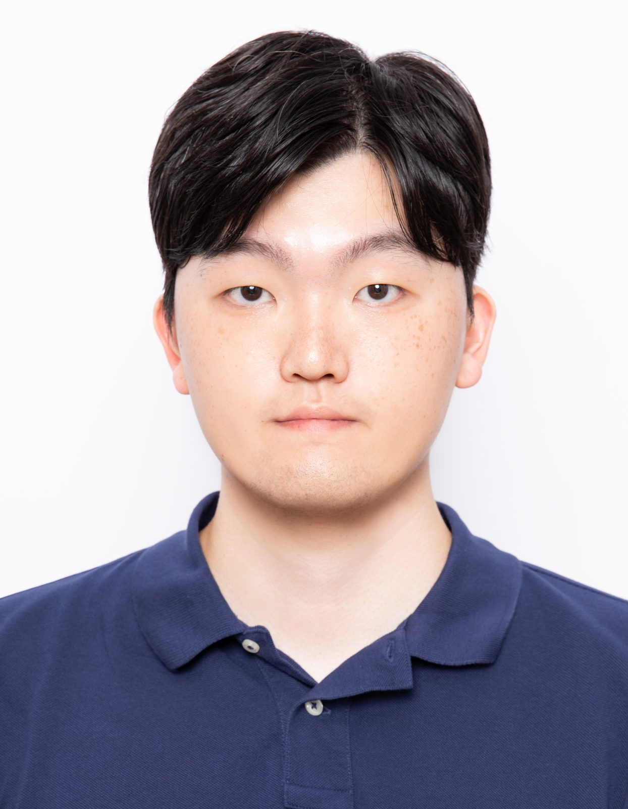

Research Intern

<figure class="board-fig"></figure>

## Sang Yeon Yoon

<code>yskite09@gmail.com</code> <code>palsc@pukyong.ac.kr</code>

> [Personal page](https://glesep.github.io/)

## Research Interests

- Efficient AI
- Multi-Agent System

## **Publication**

**(\* indicates equal contribution, † indicates corresponding author)**

### **International Conference Papers**

**\[C1\] Focus Matters: Attention-Value Dynamics for Hallucination Mitigation in Vision-Language Models**

Sohyeon Kim, **Sang Yeon Yoon**, Kyeongbo Kong†

**NeurIPS,** Dec. 2026.

### **International Workshop Papers**

**\[W1\] Mitigating Visual Hallucinations for Reliable Multimodal Agents**

Sohyeon Kim, **Sang Yeon Yoon**, Kyeongbo Kong†

**ICMLw,** Jul. 2026.

### **Domestic Conference Papers**

**\[D2\] 대규모 비전-언어 모델의 객체 환각 완화를 위한 비전 인코더 Attention-Value 동역학 분석** **(우수학생논문상)**

김소현, **윤상연**, 공경보†

**대한전자공학회 하계종합학술대회,** June. 2026.

**\[D1\] 입력 모달리티에 따른  3D 거대 멀티모달 모델 연구 동향 조사**

**윤상연**, 백창우, 김소현, 공경보†

**대한전자공학회 하계종합학술대회,** June. 2026.

## Project

### LG전자

- 홈로봇 객체 변화 기반 공간 정돈도 감지 기술 개발, LG전자, 공동연구원 (May 2026 ~ Nov. 2026)
