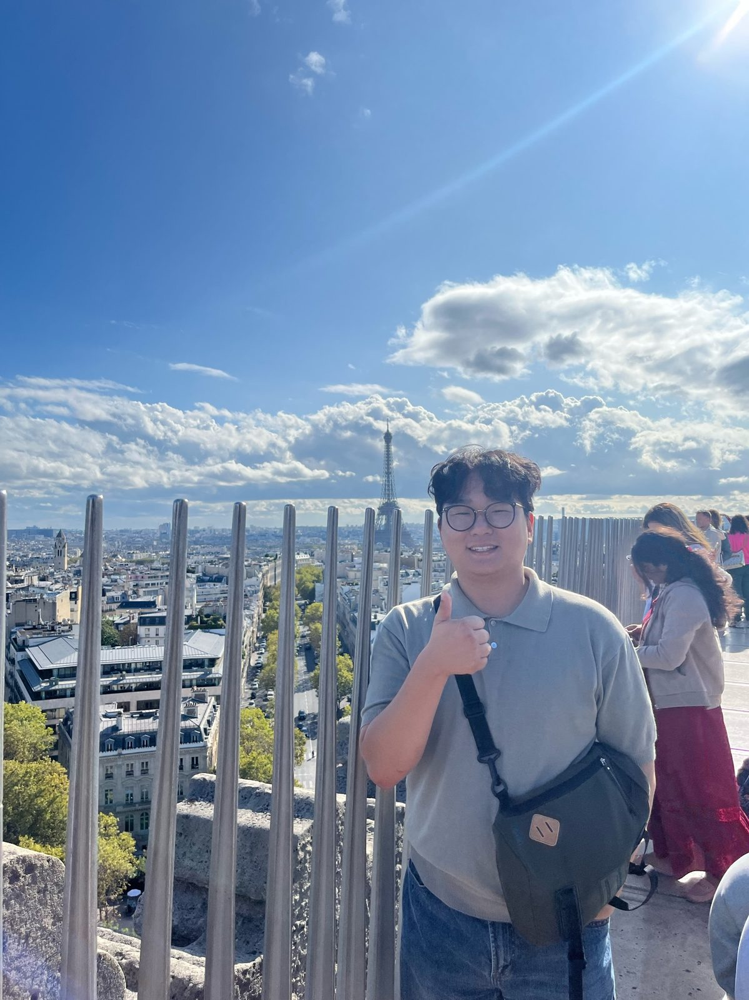

Ph.D. Course

<figure class="board-fig"></figure>

## **Seong-Hun Jeong**

<code>tlqwkrk915@naver.com</code>    

## Research Interests

- AI for CAD
  - Reverse Engineering
  - LLM/VLM

## **Publication**

### **Submitted**

**\[J2\] Embedding-Space Localization for Robust 3D TDOA Estimation**  **Seong-Hun Jeong\***, Hyeongju Mun, Dongho Kim, Youngik Choi, Kiin Kim, Hyosang Moon, Yonggi Hong and, Kyeongbo Kong†, (Submitted)

### International Journal Papers

**\[J1\] Motion-to-Attention: Enhancing Attention Maps to Improve Performance of Text-Guided Video Editing**

**Seong-Hun Jeong\***, In-Hwan Jin\*, Haesoo Choo\*, Hyeonjun Na\*, Kyeongbo Kong†

**ACM Transactions on Multimedia Computing, Communications, and Applications (ACM TOMM)**

(IF: 6.0, JCR 7.8%)

[<code>Project Page</code>](https://currycurry915.github.io/Motion-to-Attention/)    [<code>Code</code>](https://github.com/currycurry915/ACMTOMM_M2A)  

### **International Conference Papers**

**\[C7\] Optimizing 4D Gaussians for Dynamic Scene Video from Single Landscape Images**  In-Hwan Jin\*, Haesoo Choo\*, **Seong-Hun Jeong**, Heemoon Park, Junghwan Kim, Oh-joon Kwon, Kyeongbo Kong†

**ICLR** 2025, Apr, 2025   (Top-tier AI conference, Acceptance Rate: 32.08%)

**\[C6\] Dynamic Scene Reconstruction from Single Landscape Image Using 4D Gaussian in the Wild**

Inhwan Jin\*, Haesoo Choo\*, **Seong-Hun Jeong,** Heemoon Park, Junghwan Kim, Oh-joon Kwon, Kyeongbo Kong†

**ECCVW** 2024, Sep, 2024

**\[C5\] Text-to-Video Editing using Direction Information of Optical Flow**

**Seong-Hun Jeong\***, Kyeongbo Kong†

***ICCE-Asia****,* Oct, 2023.

**\[C4\] Enhancing Text-to-Video Editing with Motion Map Injection**  **Seong-Hun Jeong\***, Inhwan Jin\*, Haesoo Choo\*, Hyunjun Na\*, Kyeongbo Kong†

**ICCVW***,* Oct. 2023. (Top-tier AI conference workshop) (Oral Presentation Invitation)

**\[C3\] Digital Handwriting Correction Using Deep Learning**  Dong-Hoon Kim\*, Hyunjun Na\*, **Seong-Hun Jeong\***, Nayoung Kim, Kyeongbo Kong†  International Conference on Electronics, Information, and Communication (**ICEIC**). Feb. 2023. (Best Paper Award)

**\[C2\] An Unified Framework for Language Guided Image Completion**  Jihyun Kim\*, **Seong-Hun Jeong\***, Kyeongbo Kong\*, Suk-Ju Kang† **WACV,** Jan. 2023. (**Second-tier AI Conference,** **Acceptance Rate in Round 2: 29.1%**)

### **Domestic Conference Papers**

**\[C3\] 단일 풍경 이미지의 Dynamic Scene Video 생성을 위한 4D Gaussian Splatting 최적화 알고리즘 구현**

진인환\*, 추해수\*, **정성훈**, 공경보†  제34회 인공지능신호처리 학술대회, Oct. 2024.

**\[C2\] Optical Flow의 방향 정보를 활용한 Text-to-Video 편집 기술**  **정성훈\***, 진인환, 추해수, 공경보†  대한임베디드공학회 ICT 대학생 논문 경진대회, Jul. 2024. (장려상)

**\[C1\] YOLO 네트워크를 이용한 단자 구분**  정다운\*, **정성훈**, 김재윤, 정지훈, 공경보†  한국방송미디어공학회 추계학술대회, Nov. 2022. (최우수상)

### **Domestic Journal Papers**

**\[J1\] 딥러닝 기반 단일 이미지 생성적 적대 신경망 기법 비교 분석**  **정성훈\*,** 공경보†  방송공학회논문지 제27권 제3호, May 2022. [\[Paper\]](https://www.kci.go.kr/kciportal/ci/sereArticleSearch/ciSereArtiView.kci?sereArticleSearchBean.artiId=ART002845402)

**\[J2\] 버추얼 프로덕션을 위한 딥러닝 기반 2.5D 배경 에셋 생성 기술 연구**  추해수\*, 진인환, **정성훈**, 공경보†

## Patents

- 공경보, 최서영, 최광동, 우민수, **정성훈**, "비디오 두부 충동 검사 데이터 분석 방법 및 장치", 출원일자: 2026년 1월 6일, 출원번호: 10-2026-0002233, 부산대학교 산학협력단, 부산대학교병원
- 문형주, **정성훈**, 공경보, 김형남, 전민욱, 권순영, 채주희, 박진오, 이명식, 최영익, 김기인, 길기성, 이진희, 홍용기, 이시혁, 장유정, 김진우, 박종현, "TDOA 위치 추정 시스템 및 이를 이용한 위치 추정 방법", 출원일자: 2025년 8월 6일, 출원번호: 10-2025-0108527, 엘아이지넥스원 주식회사, 부산대학교 산학협력단
- 공경보, 진인환, 추해수, **정성훈**, "4차원 모델 정보의 생성 방법 및 장치", 출원일자: 2024년 9월 13일, 출원번호: 10-2024-0125265, 부산대학교 산학협력단 (기술이전)
- 권오준, 공경보, **정성훈**, "깊이 값 추정 인공지능을 이용한 고효율의 입체영상 변환방법 및 이를 이용한 시스템", 출원일자: 2023년 10월 27일, 출원번호: 10-2023-0145718, 주식회사 디엠스튜디오
- 문형주, **정성훈**, 공경보, 김형남, 전민욱, 권순영, …“TDOA 위치 추정 시스템 및 이를 이용한 위치 추정 방법”, 부산대학교 산학협력단 / LIG 넥스원 주식회사

## Projects

### **부산대학교병원(2024.9~Present)**

- 안구운동검사 신호 분석 기술, 부산대학교병원, Korea/ **참여연구원** (Sep. 2024 ~ Present)

### ETRI(2023.08~2024.11)

- 4D 공간표현 생성 및 라이트필드 비디오 렌더링 SW 구현, ETRI, Korea/ **참여연구원** (Aug. 2024 ~ Nov. 2024)
- 개방형 기획을 위한 초실감 디스플레이 디바이스 분야 기술분석 및 연구추진 방향 도출, ETRI, Korea/ **참여연구원** (Aug. 2023 ~ Dec. 2023)

### LIG 넥스원(2023.11~2025.9)

- 다중송신원 환경 TDOA Hybrid 위치추정 기술, LIG Nex1, Korea/ **공동연구원** (Nov. 2023 ~ Sep. 2025)

### **LG 전자(2021.04~2024.12)**

- 홈로봇 환경을 고려한 야간 사람 인식 기술 개발 및 주간 얼굴 인식 성능 개선, LG Electronics, Korea/  **참여연구원** (Dec. 2023 ~ Dec. 2024)
- 차량용 디스플레이 화질 보정 및 적응적 소비전력 저감 기술 개발, LG Electronics, Korea/  **참여연구원** (Mar. 2023 ~ Nov. 2023)

### **방송문화진흥회(2023.07~2024.11)**

- 생성형 AI를 활용한 실감형 해양콘텐츠 제작 체계 개발, 부산MBC, Korea/  **참여연구원** (Jul. 2023 ~ Nov. 2024)

### **부산테크노파크(2023.07~2023.11)**

- 지역수요기반 실감콘텐츠 제작환경을 위한 AI 애셋 생성 플랫폼 개발, 부산테크노파크, Korea/  **참여연구원** (Jul. 2023 ~ Nov. 2023)
