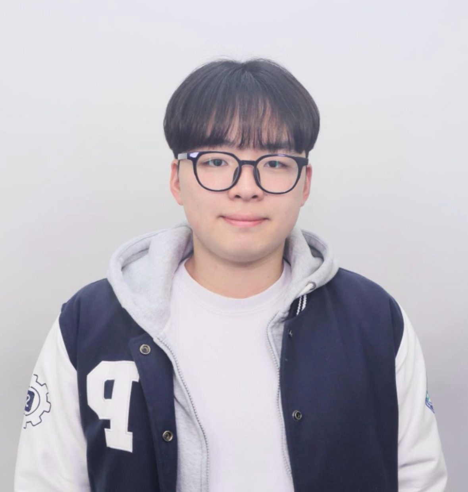

Integrated BS-MS  Course

<figure class="board-fig"></figure>

## Kim Woo Hyeong

<code>zovw8179@pusan.ac.kr</code>

## Research Interests

- Physics-Aware 3D/4D World Modeling
  - Dynamic Scene Generation
  - Material Property Estimation
  - Efficient Physics Simulation

## **Publication**

**(\* indicates first author, † indicates corresponding author)**

### **Submitted**

**\[S1\] Anonymized Title** Sohyeong Kim\*, **Woo Hyeong Kim\***, In-Hwan Jin\*, Joonsoo Kim, Kugjin Yun, Kyeongbo Kong†

### **International Conference Papers**

**\[C4\] Counterfactual Simulation-Guided Physical Reasoning for Physics-Based Video Generation** Sohyeong Kim\*, **Woo Hyeong Kim\***, In-Hwan Jin\*, Hyeongju Mun, Kyeongbo Kong† **ECCVW,** 2025. (Top-tier AI conference workshop) [<code>Paper</code>](https://eccv2026-3d-world-models.github.io/papers/files/25-counterfactual-simulation-guided-physical-reasoning-for-physics-based-video-gene.pdf)  [<code>Project Page</code>](https://annon-repo-for-science.github.io/CounterFactual/)  

**\[C3\] Structured Redundancy Modeling for Efficient Visual Token Pruning in High-Resolution MLLMs** Jouwon Song\*, **Woohyeong Kim**, Seungjae Baek, Kyeongbo Kong† European Conference on Computer Vision (**ECCV**), Sep. 2026. (**Top-tier AI Conference**, **Acceptance Rate: 27.5%**)

[<code>Paper</code>](https://arxiv.org/pdf/2607.23046)

**\[C2\] SFPruner: Single-Forward Visual Token Subset Selection for Resource-Efficient Multimodal Foundation Model Inference** Jouwon Song\*, **Woohyeong Kim**, Seungjae Baek, Kyeongbo Kong† **ICMLw**, Jul. 2026. (Top-tier AI conference Workshop)

### **Domestic Conference Papers**

**\[C1\] 단일 이미지 기반 물리적 행동 조건부 비디오 및 4D Scene 생성 기술 연구 동향**  **김우형\***, 문형주, 공경보† 대한전자공학회 하계학술대회, June.2026.

## **Project**

